<p align="center">
  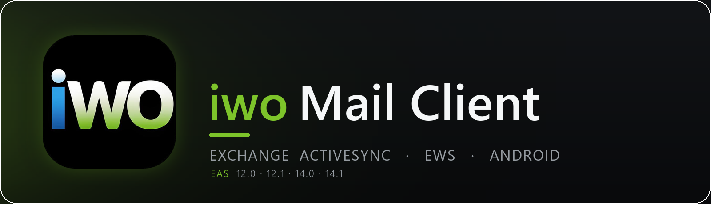
</p>

<p align="center">
  <a href="https://github.com/DedovMosol/IwoMailClient/actions/workflows/ci.yml"></a>
  <a href="https://github.com/DedovMosol/IwoMailClient/releases"></a>
  <a href="LICENSE"></a>
  
  
  
</p>

<div align="justify">

🇬🇧 **English:** [README_EN.md](README_EN.md)

Почтовый клиент для Android с основным фокусом на **Microsoft Exchange Server 2007 SP1+** через **Exchange ActiveSync (EAS)** и **Exchange Web Services (EWS)**. IMAP/POP3 присутствуют как beta-направление с ограниченной функциональностью.

> **Важно:** 🚧 Работа над проектом активно ведётся. Следующая версия в релизе — **1.7.0**. Отличия от 1.6.1 и последующих beta-сборок будут значительными.

**Версия:** 1.6.3b (beta, versionCode 26; последний опубликованный релиз — 1.6.1) · **Пакет:** `com.dedovmosol.iwomail` · **Разработчик:** DedovMosol · **Telegram:** [@i_wantout](https://t.me/i_wantout) · **Email:** andreyid@outlook.com

## 📖 О проекте

- **Production-фокус:** Exchange 2007 SP1/SP2 и совместимые on-premise Exchange-серверы.
- **Основной протокол:** EAS 12.0/12.1/14.0/14.1 для почты, папок, контактов, Direct Push и части операций.
- **EWS-дополнение:** календарь, задачи, заметки, черновики, вложения календаря, ответы на встречи и fallback-сценарии для Exchange 2007.
- **Auth:** Basic Auth; для EWS-операций дополнительно NTLMv2-fallback. EAS-транспорт работает только с Basic Auth. OAuth 2.0 / Modern Auth пока не реализованы.
- **Локальная модель:** offline-first через Room DB, UI читает данные через Flow, фоновые сервисы обновляют базу.

## ✨ Возможности

- **📧 Почта:** синхронизация системных и пользовательских папок, отправка HTML-писем, вложения, inline-изображения, CC/BCC, важность, поиск, фильтры, избранное, цепочки писем (по `ConversationId` на EAS 14.0+, по теме на Exchange 2007), мультивыбор, batch-операции, настраиваемые свайпы влево/вправо (в «Удалённые», прочитано/непрочитано, флаг).
- **🚩 Флаги:** флаг к исполнению со сроком и напоминанием (`[MS-ASEMAIL] Flag`, как в Outlook); звезда ставится сразу, при отказе сервера возвращается к значению на сервере. Звезда и «прочитано», выставленные без связи, сохраняются локально, попадают в очередь `pending_email_changes` и отправляются на сервер позже (`PendingMailChangesWorker`).
- **📖 Чтение:** картинки из интернета по умолчанию не загружаются (показать для письма, доверенные отправители, «всегда загружать»), отписка от рассылок (`List-Unsubscribe`, one-click по RFC 8058), печать и сохранение в PDF через системный диалог печати, сохранение письма в `.eml`, ответ на запрос отчёта о прочтении (отказ — EWS `SuppressReadReceipt`), RSS-записи Outlook (`IPM.Post.RSS`) со ссылкой на статью.
- **📝 Черновики:** серверный режим через Exchange/EWS и локальный beta-режим, выбор режима в онбординге и настройках аккаунта.
- **📤 Отправка:** отложенная отправка (точный будильник + WorkManager) и экран запланированных писем (отправить сейчас, перенести, отменить), очередь исходящих для offline-сценариев, отмена отправки (0/5/10/20/30 с), запросы MDN/DSN.
- **👥 Контакты:** локальные и Exchange-контакты, GAL, группы, избранное, импорт/экспорт vCard/CSV, автодополнение адресов.
- **🗓 Календарь:** события, встречи, участники, ответы на приглашения, повторения, исключения, напоминания, вложения, онлайн-ссылки, цвета категорий (Master Category List на Exchange 2010+, стандартные цвета Outlook, ручное назначение), локальная корзина, окончательное удаление только после подтверждения сервера, сброс и повторная синхронизация.
- **✅ Задачи:** активные/выполненные/важные/просроченные задачи, сроки, приоритеты, назначение, напоминания, корзина и восстановление, сброс и повторная синхронизация; правка и корзина без связи сохраняются на устройстве и уходят на сервер, когда связь появится (`pending_pim_changes`).
- **🗒 Заметки:** синхронизация Exchange Notes, создание/редактирование, корзина и восстановление, сброс и повторная синхронизация; правка и корзина без связи — как у задач.
- **🔔 Уведомления:** Direct Push через EAS Ping, WorkManager-синхронизация, AlarmManager fallback, уведомления писем, календаря, задач, флагов, обновлений и исходящих, тап по напоминанию календаря/задачи/флага переключает на тот аккаунт и открывает элемент, свои каналы уведомлений на каждый аккаунт (звук и важность — в системных настройках), тихие часы и важные отправители (их письма звучат и в тихие часы), уведомление о потере связи с сервером.
- **🔐 Блокировка приложения:** пароль (хранится только PBKDF2-HMAC-SHA256-хеш, 600 000 итераций) и отпечаток пальца; блокировка при холодном старте и при уходе приложения в фон.
- **🎨 Интерфейс:** Jetpack Compose, Material 3, RU/EN локализация, тема светлая/тёмная/как в системе, цветовые схемы, ежедневные темы, кастомные иконки файлов, drag selection; настройки разделены на «Аккаунты», «Почта», «Уведомления», «Персонализация», «Безопасность», «О приложении».
- **📊 Виджет и shortcuts:** домашний виджет Glance, быстрый доступ к письмам, поиску, календарю, задачам и созданию письма; данные виджета читаются лёгкими Room-проекциями без загрузки тяжёлых тел писем/событий.
- **⬆️ Обновления:** проверка `update.json` на GitHub, выбор APK по ABI, скачивание, установка и подготовка отката.

<details>
<summary><b>🗓 Календарь и вложения — как это устроено</b></summary>

- **DRY для повторяющихся событий:** вложения календаря хранятся как JSON-метаданные (`fileReference`, имя, размер), а не как копии файлов для каждого occurrence.
- **Exchange 2007 SP1:** загрузка/получение вложений календаря идёт через EWS `CreateAttachment`/`GetItem`; для recurring-серий используется master ItemId.
- **Окончательное удаление:** локальное удаление из БД выполняется только после успешного удаления на сервере; операции сериализованы с календарной синхронизацией per-account mutex.
- **Защита от CRA resurrection:** attendee-встречи перед удалением отклоняются через `MeetingResponse`/EWS `DeclineItem`; если исходный meeting request не найден, локальное удаление не выполняется.
- **Приглашения на встречи:** на Exchange 2010/2013 (EAS 14.x) встречи с участниками создаются и правятся через EWS `CreateItem`/`UpdateItem`, чтобы сервер разослал приглашения/обновления; обычная встреча без участников остаётся на EAS.
- **Preview cache:** предпросмотр вложений использует временный каталог `cacheDir/calendar_preview`, стабильные имена по `fileReference` и отложенную очистку без гонок с внешними просмотрщиками.

</details>

<details>
<summary><b>🧩 Виджет и производительность</b></summary>

- **Лёгкие DAO-проекции:** виджет читает только отображаемые поля для последних непрочитанных писем, ближайшей задачи и события календаря.
- **Корректная логика непрочитанных:** список новых писем в виджете фильтруется по Inbox и `read = 0`.
- **Защита от гонок:** `updateMailWidget()` сериализует `GlanceAppWidget.updateAll()` через общий mutex и использует `applicationContext`.
- **Адаптивная раскладка:** нижний ряд действий подстраивается под ширину виджета (Glance `Row` не переносит содержимое) — на узких размерах меньше аватаров и без метки времени синхронизации, чтобы кнопки не обрезались; аватары масштабируются вместе с виджетом.
- **Индексы Room (миграция 41→42):** индексы под горячие widget-запросы: unread Inbox, тип папки, активные задачи, текущие и ближайшие события календаря. Текущая версия схемы — v53.

</details>

## 📸 Скриншоты

| | |
|:-:|:-:|
| 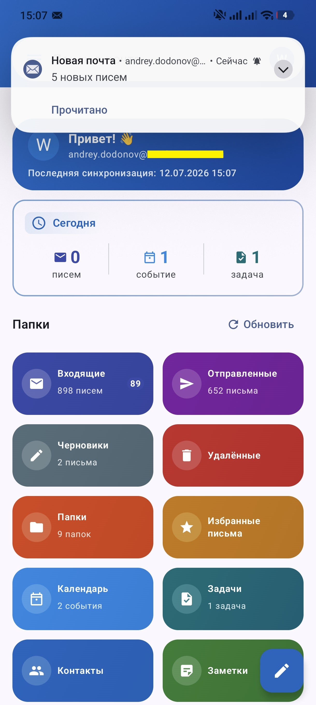<br>**Главный экран** — сводка дня и плитки разделов | 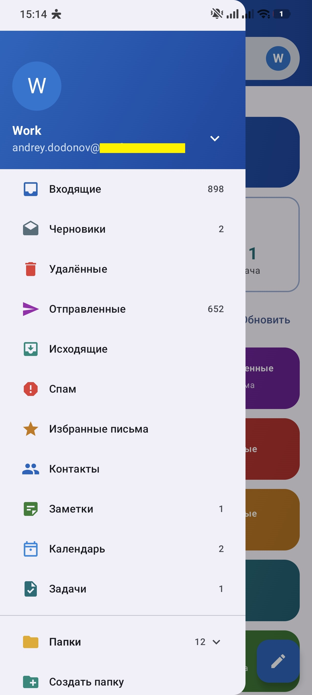<br>**Боковое меню** — папки и разделы |
| 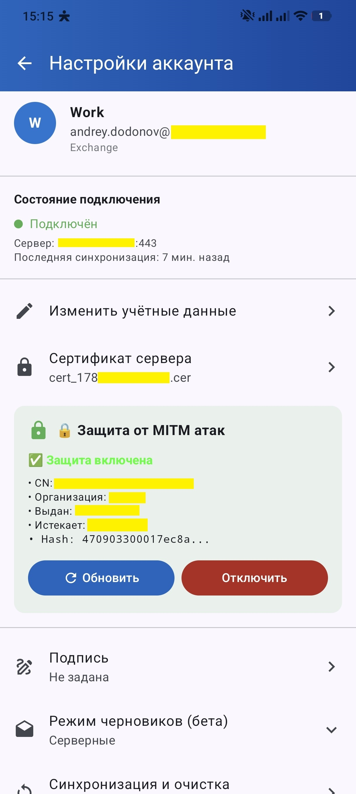<br>**Настройки аккаунта** | 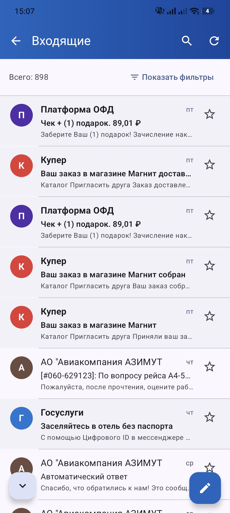<br>**Входящие** |
| 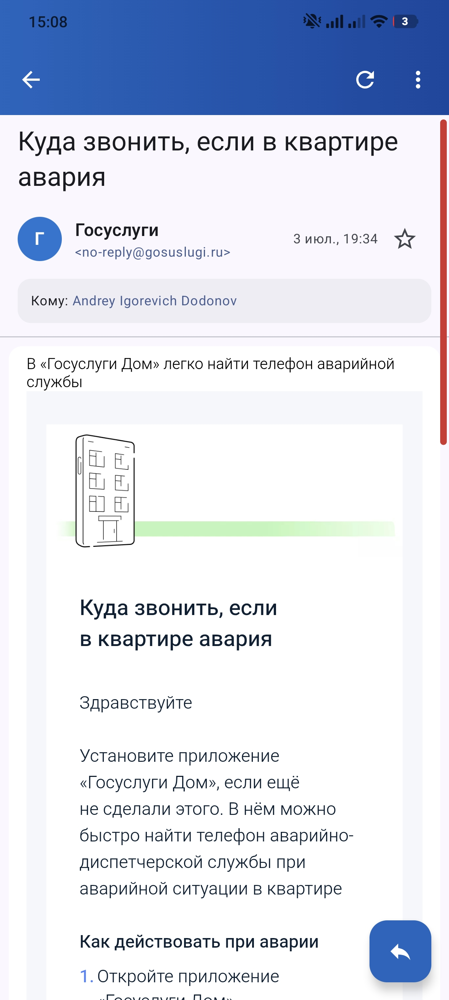<br>**Просмотр письма** — HTML-рендеринг | 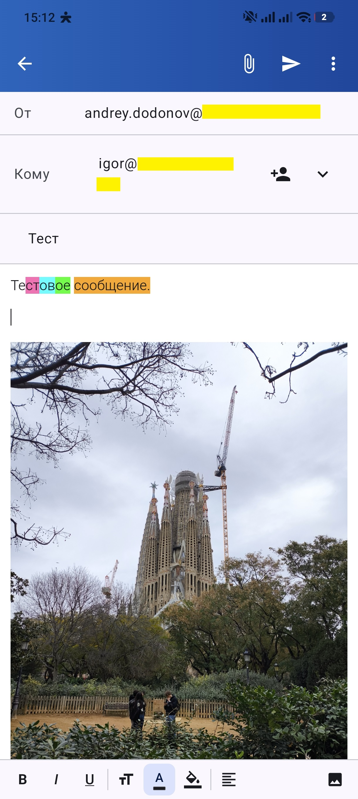<br>**Создание письма** |
| 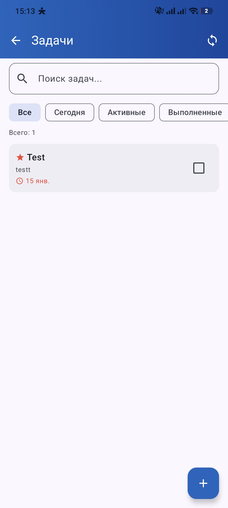<br>**Задачи** — фильтры, приоритеты, сроки | 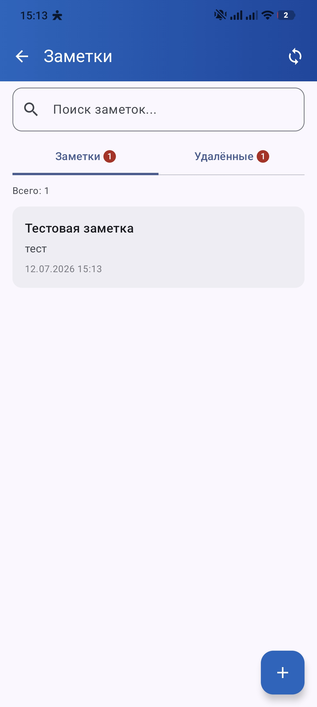<br>**Заметки** |
| 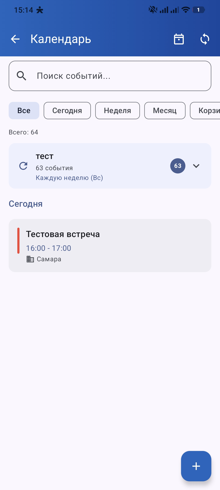<br>**Календарь (список событий)** | 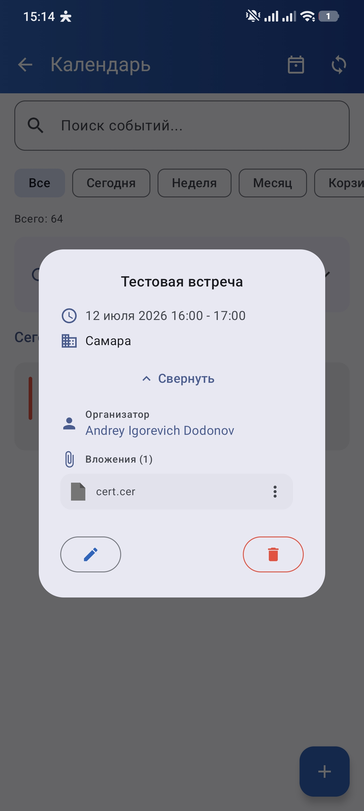<br>**Просмотр события календаря** |

## ⬇️ Установка

1. Откройте страницу [**Releases**](https://github.com/DedovMosol/IwoMailClient/releases) и скачайте последнюю версию.
2. Выберите *.apk под архитектуру вашего устройства (или `universal`, если не уверены):

   | ABI | Для каких устройств |
   |-----|---------------------|
   | `arm64-v8a` | большинство современных телефонов (рекомендуется) |
   | `armeabi-v7a` | старые 32-битные ARM-устройства |
   | `x86_64` / `x86` | эмуляторы и x86-планшеты |
   | `universal` | один APK для всех архитектур |

3. Разрешите установку из этого источника и установите *.apk.
4. При первом запуске пройдите онбординг и добавьте аккаунт Exchange.

> Встроенный апдейтер проверяет `update.json` в репозитории, подбирает *.apk по ABI и готовит откат.

## 🖥 Требования

| Параметр | Минимум | Рекомендуется |
|----------|---------|---------------|
| Android | 8.0+ (API 26) | — |
| RAM | 2 ГБ | 4+ ГБ |
| Свободное место | 50 МБ | 100+ МБ |
| CPU/ABI | armeabi-v7a / x86 | arm64-v8a / x86_64 |

- **Compile SDK:** 36 · **Target SDK:** 36 · **Java/Kotlin target:** JVM 17
- **APK:** universal + ABI splits для `armeabi-v7a`, `arm64-v8a`, `x86`, `x86_64`
- **Сборка:** требуется JDK 17 (минимальная версия для Android Gradle Plugin 8.x)

## 🔌 Поддерживаемые серверы

| Сервер | Статус |
|--------|--------|
| Exchange 2007 SP1/SP2 | ✅ Стабильный основной сценарий |
| Exchange 2010/2013/2016 on-premise | 🟡 Архитектурно поддерживается через EAS/EWS, требует проверки на конкретной инфраструктуре |
| Office 365 / Exchange Online | 🟠 Ограничено: требуется OAuth/Modern Auth, который пока не реализован |
| IMAP/POP3 | 🧪 Beta: чтение/синхронизация через JavaMail, без полного parity с Exchange |

## 🔒 Безопасность и совместимость

- **Conscrypt:** добавлен для TLS 1.0/1.1 и совместимости со старыми Exchange 2007-инсталляциями.
- **Сертификаты сервера:** поддержка системных, пользовательских и самоподписанных сертификатов.
- **mTLS:** клиентские сертификаты PKCS#12 (`.p12`/`.pfx`) с кэшированием KeyManager.
- **Certificate Pinning:** хранение SHA-256, CN/O и дат сертификата в аккаунте; у резервного сервера — свой пин.
- **Hostname verification:** для импортированного сертификата сервера — `Rfc6125HostnameVerifier` (SAN dNSName/iPAddress, CN только при отсутствии SAN).
- **Без cleartext:** `network_security_config.xml` запрещает HTTP (`cleartextTrafficPermitted="false"`).
- **Пароли:** `EncryptedSharedPreferences` (Android KeyStore, AES256-SIV/AES256-GCM) для основного пути; при недоступности KeyStore — запасное `ObfuscatedSharedPreferences`: XOR с ключом, выведенным PBKDF2-HMAC-SHA256 из `ANDROID_ID` (обфускация, не шифрование). Пользователь получает однократное предупреждение; fail-closed режим есть в коде (`SecurityTelemetry`), но переключателя в настройках нет.
- **Alternate URL:** основной и резервный URL Exchange с fallback при сетевых ошибках и последующим auto-switchback.
- **XSS-защита тел писем:** `sanitizeEmailHtml` блокирует `<script>`, plugin-контейнеры (`iframe`/`object`/`embed`/`applet`), event-handlers, `meta http-equiv="refresh"`, `javascript:` и `data:text/html` URI во всех атрибутах с URL-контекстом; комбинируется с нонс-CSP и `loadDataWithBaseURL(null, ...)` в WebView для изоляции от cross-origin контекста.

## ⚠️ Известные ограничения

- **OAuth 2.0 / Modern Auth:** не поддерживается.
- **Office 365:** без Basic Auth обычно не работает.
- **NTLM для EAS:** EAS-транспорт поддерживает только Basic Auth (NTLMv2 применяется только к EWS-операциям), виртуальный каталог `/Microsoft-Server-ActiveSync` должен разрешать Basic Auth.
- **IMAP/POP3:** beta-реализация, не покрывает календарь, контакты, задачи, заметки, Direct Push и EWS-функции. Отправки через SMTP нет: адрес исходящего сервера только сохраняется в аккаунте.
- **Offline-очередь:** звезда и «прочитано» писем, правка и перенос в корзину задач и заметок. Создание задач и заметок, календарь, операции с папками и перемещения писем пока выполняются «сервер первым» и без связи не откладываются.
- **Контакты Exchange:** только чтение. Они приходят из папки «Контакты» на сервере (EAS Sync), править и удалять их нужно в Outlook или OWA. В приложении контакт Exchange можно скопировать в личные контакты и уже их редактировать.
- **Проверка на устройстве:** исправление горизонтальной прокрутки в просмотре письма и восстановление WebView после гибели процесса отрисовки покрыты unit-тестами, но на реальном устройстве не проверялись.
- **S/MIME:** подписи и шифрование не реализованы.
- **EAS 16.x:** явно не является целевой версией проекта; основной диапазон в коде — EAS 12.x-14.1.

## 🧱 Технологический стек

| Категория | Технологии |
|-----------|------------|
| Язык | Kotlin 1.9.22, Java 17 |
| Сборка | Gradle 8.12, AGP 8.7.3, KSP 1.9.22-1.0.17, Kover 0.7.6, minSdk 26, targetSdk 36 |
| UI | Jetpack Compose, Compose BOM 2024.06.00, Material 3, Navigation 2.7.6, Lifecycle/ViewModel 2.7.0 |
| Асинхронность | Coroutines 1.7.3, Flow |
| Хранилище | Room 2.6.1 (`MailDatabase` v53), DataStore Preferences 1.1.1 |
| Сеть | OkHttp 4.12.0, Conscrypt 2.5.2 |
| Протоколы | EAS, EWS, JavaMail IMAP/POP3 (`android-mail` 1.6.7) |
| Фоновые задачи | WorkManager 2.9.0, Foreground Service, AlarmManager |
| Безопасность | AndroidX Security Crypto 1.1.0-alpha06, Biometric 1.1.0 (+ Fragment 1.8.6), TLS/mTLS, Certificate Pinning |
| UI extras | Coil 2.5.0, Glance AppWidget 1.1.1 |
| Тесты | JUnit 4.13.2, MockK 1.13.8, Truth 1.1.5, Robolectric 4.12.2 |
| DI | Manual DI через `RepositoryProvider` |

## 🏗 Архитектура

```text
UI Layer
  Jetpack Compose, Navigation, Theme, Localization
  MainScreen, Setup/Verification, Mail, Compose, Contacts, Calendar, Notes, Tasks, Settings, Lock, Updates
    ↓
Repository Layer
  AccountRepository, MailRepository, CalendarRepository, ContactRepository,
  NoteRepository, TaskRepository, SettingsRepository, AccountServerHealthRepository
  EmailSyncService, EmailOperationsService, FolderSyncService, AppFileCleanupService
    ↓
Protocol Layer
  EasClient facade
  EasTransport + EAS services + EWS client + IMAP/POP3 beta clients
    ↓
Persistence / Network
  Room MailDatabase v53, DataStore
  HttpClientProvider, NetworkMonitor, NtlmAuthenticator
    ↓
Background
  PushService, SyncWorker, OutboxWorker, PendingMailChangesWorker, scheduled send, reminders, notifications, watchdogs
```

Подробно: [Архитектура проекта](docs/ARCHITECTURE.md) · [EN](docs/ARCHITECTURE_EN.md)

## 🛠 Сборка

Рекомендуемый production-способ сборки — через Android Studio с JDK 17. CLI-команды ниже подходят как вспомогательный вариант при корректно настроенном `JAVA_HOME`.

```bash
./gradlew assembleDebug
./gradlew assembleRelease
```

На Windows:

```powershell
.\gradlew.bat assembleDebug
.\gradlew.bat assembleRelease
```

## 📚 Документация

- [История изменений RU](docs/CHANGELOG_RU.md)
- [История изменений EN](docs/CHANGELOG_EN.md)
- [Архитектура проекта (RU)](docs/ARCHITECTURE.md) · [Project Architecture (EN)](docs/ARCHITECTURE_EN.md)
- [Модель безопасности](docs/SECURITY.md) · [Сообщить об уязвимости](SECURITY.md)
- [Политика конфиденциальности](docs/PRIVACY_POLICY.md)
- [План миграции XML-парсинга](docs/XMLPULLPARSER_MIGRATION_PLAN.md)

## ♻️ Важно: переименование пакета

Версия 1.6.1 изменила пакет с `com.iwo.iwomail` на `com.dedovmosol.iwomail`.

- Обновление старых APK как обычный апдейт невозможно: Android считает это другим приложением.
- Нужна переустановка: удалить старую версию, установить новую и заново добавить аккаунты.
- Перед переходом со старого пакета рекомендуется экспортировать локальные контакты/данные.

## 💬 Обратная связь

- **Telegram:** [@i_wantout](https://t.me/i_wantout)
- **Email:** andreyid@outlook.com
- **Issues:** [GitHub Issues](https://github.com/DedovMosol/IwoMailClient/issues)

## ⚖️ Лицензия

Распространяется на условиях [GNU General Public License v3.0](LICENSE). Версии до перехода на GPLv3 выпускались под MIT и остаются под ней.

---

© 2025-2026 DedovMosol

</div>
