<p align="center">
  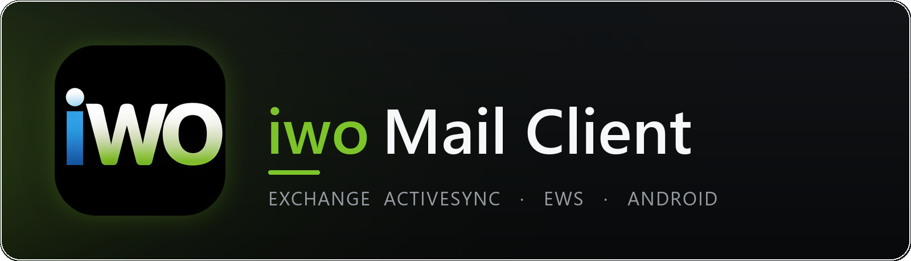
</p>

<p align="center">
  <a href="https://github.com/DedovMosol/IwoMailClient/actions/workflows/ci.yml"></a>
  <a href="https://github.com/DedovMosol/IwoMailClient/releases"></a>
  <a href="LICENSE"></a>
  
  
  
</p>

<div align="justify">

🇷🇺 **Русская версия:** [README.md](README.md)

Android mail client focused on **Microsoft Exchange Server 2007 SP1+** through **Exchange ActiveSync (EAS)** and **Exchange Web Services (EWS)**. IMAP/POP3 are present as a beta direction with limited functionality.

> **Important:** 🚧 The project is under active development. The next release will be **1.7.0**. It will differ significantly from 1.6.1 and the subsequent beta builds.

**Version:** 1.6.3b · **Package:** `com.dedovmosol.iwomail` · **Developer:** DedovMosol · **Telegram:** [@i_wantout](https://t.me/i_wantout) · **Email:** andreyid@outlook.com

## 📖 About

- **Production focus:** Exchange 2007 SP1/SP2 and compatible on-premise Exchange servers.
- **Primary protocol:** EAS 12.0/12.1/14.0/14.1 for mail, folders, contacts, Direct Push and part of the operations.
- **EWS addition:** calendar, tasks, notes, drafts, calendar attachments, meeting responses and fallback scenarios for Exchange 2007.
- **Auth:** Basic Auth; NTLMv2 fallback additionally for EWS operations. The EAS transport works with Basic Auth only. OAuth 2.0 / Modern Auth are not yet implemented.
- **Local model:** offline-first via Room DB, the UI reads data through Flow, background services update the database.

## ✨ Features

- **📧 Mail:** sync of system and user folders, HTML sending, attachments, inline images, CC/BCC, importance, search, filters, favorites, multi-select, batch operations.
- **📝 Drafts:** server mode via Exchange/EWS and a local beta mode, selectable in onboarding and account settings.
- **📤 Sending:** scheduled send, outbox queue for offline scenarios, undo-send, MDN/DSN requests.
- **👥 Contacts:** local and Exchange contacts, GAL, groups, favorites, vCard/CSV import/export, address autocomplete.
- **🗓 Calendar:** events, meetings, attendees, invitation responses, recurrences, exceptions, reminders, attachments, online links, local trash, permanent delete only after server confirmation.
- **✅ Tasks:** active/completed/important/overdue tasks, due dates, priorities, assignment, reminders, trash and restore.
- **🗒 Notes:** Exchange Notes sync, create/edit, trash and restore.
- **🔔 Notifications:** Direct Push via EAS Ping, WorkManager sync, AlarmManager fallback, notifications for mail, calendar, tasks, updates and outbox.
- **🎨 Interface:** Jetpack Compose, Material 3, RU/EN localization, dark/light theme, color schemes, daily themes, custom file icons, drag selection.
- **📊 Widget & shortcuts:** Glance home-screen widget, quick access to mail, search, calendar, tasks and compose; widget data is read via lightweight Room projections without loading heavy mail/event bodies.
- **⬆️ Updates:** `update.json` check on GitHub, APK selection by ABI, download, install and rollback preparation.

<details>
<summary><b>🗓 Calendar and attachments — how it works</b></summary>

- **DRY for recurring events:** calendar attachments are stored as JSON metadata (`fileReference`, name, size), not as file copies for each occurrence.
- **Exchange 2007 SP1:** calendar attachment upload/fetch goes through EWS `CreateAttachment`/`GetItem`; recurring series use the master ItemId.
- **Permanent delete:** local DB deletion happens only after successful server-side deletion; operations are serialized with calendar sync via a per-account mutex.
- **CRA resurrection prevention:** attendee meetings are declined through `MeetingResponse`/EWS `DeclineItem` before deletion; if the original meeting request cannot be found, local deletion is not performed.
- **Meeting invitations:** on Exchange 2010/2013 (EAS 14.x) meetings with attendees are created and edited through EWS `CreateItem`/`UpdateItem` so the server sends invitations/updates; a plain appointment without attendees stays on EAS.
- **Preview cache:** attachment previews use a temporary `cacheDir/calendar_preview` directory, stable names derived from `fileReference`, and delayed cleanup without races with external viewers.

</details>

<details>
<summary><b>🧩 Widget and performance</b></summary>

- **Lightweight DAO projections:** the widget reads only displayed fields for recent unread emails, the next task and the next calendar event.
- **Correct unread logic:** the widget's new-mail list is filtered by Inbox and `read = 0`.
- **Race protection:** `updateMailWidget()` serializes `GlanceAppWidget.updateAll()` through a shared mutex and uses `applicationContext`.
- **Width-adaptive layout:** the bottom action row adapts to widget width (a Glance `Row` never wraps its content) — narrow sizes show fewer avatars and hide the last-sync label so the buttons aren't clipped; avatars scale with the widget.
- **Room v42:** indexes added for hot widget queries: unread Inbox, folder type, active tasks, current and upcoming calendar events.

</details>

## 📸 Screenshots

| | |
|:-:|:-:|
| 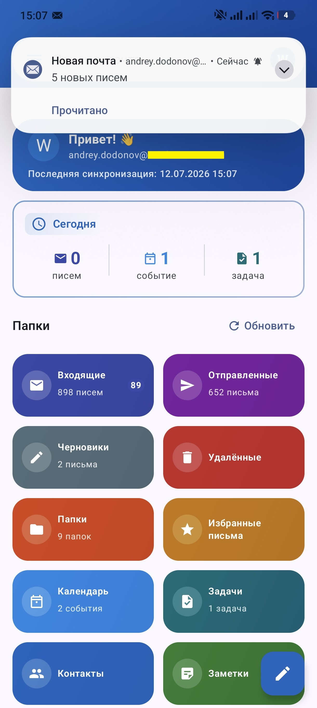<br>**Home** — daily summary and section tiles | 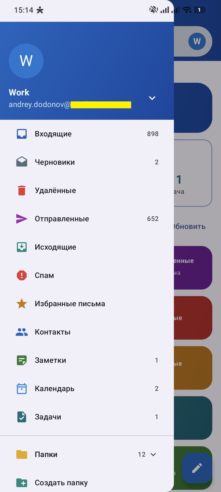<br>**Navigation drawer** — folders and sections |
| 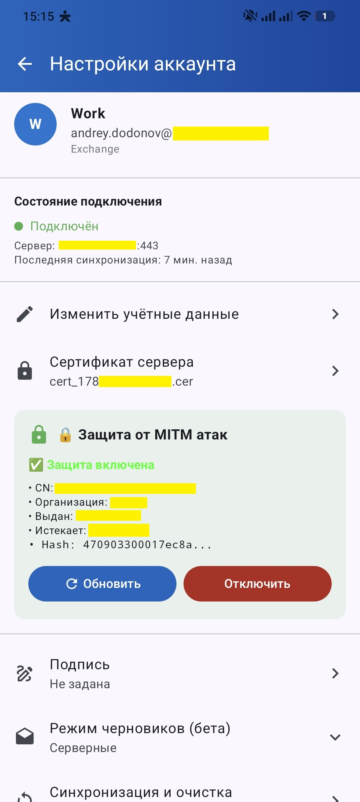<br>**Account settings** | 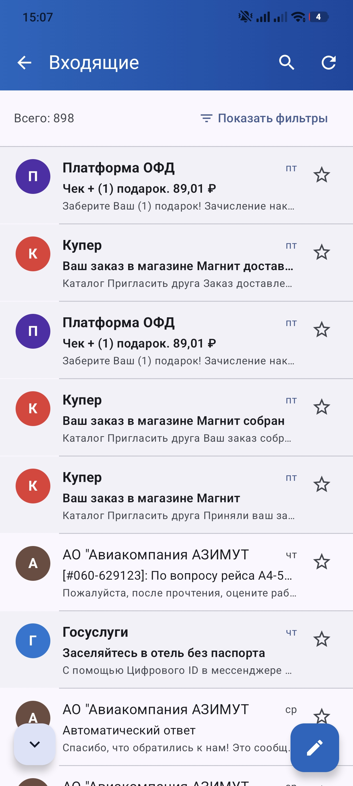<br>**Inbox** |
| 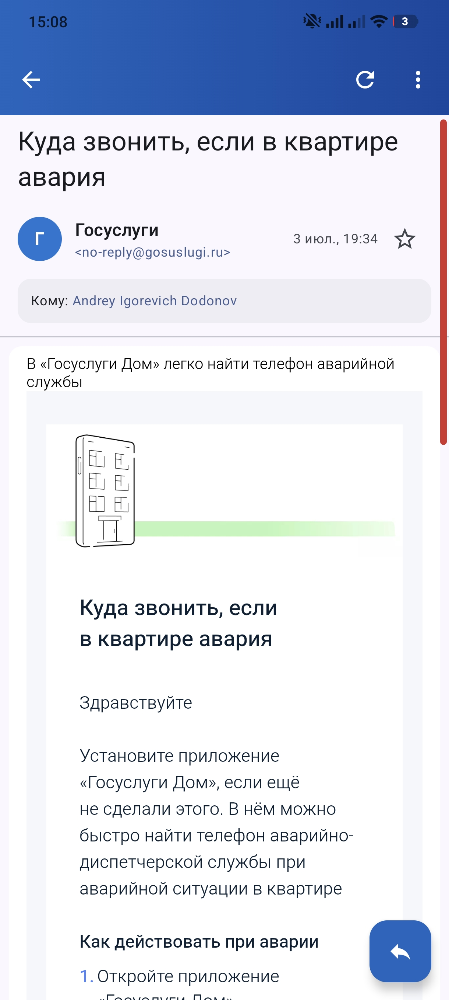<br>**Message view** — HTML rendering | 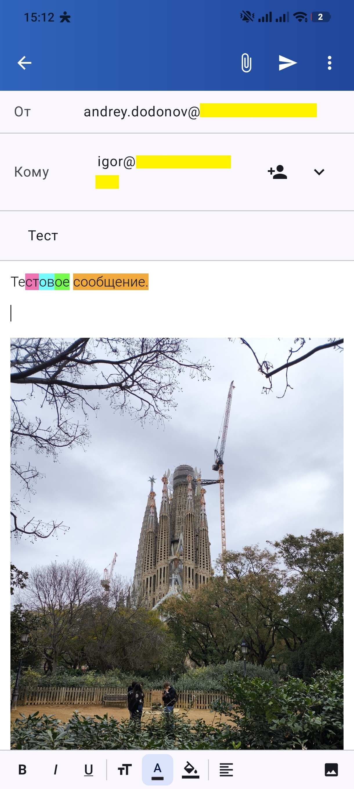<br>**Compose** |
| 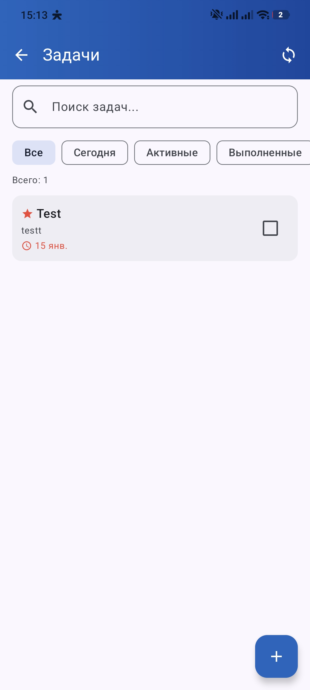<br>**Tasks** — filters, priorities, due dates | 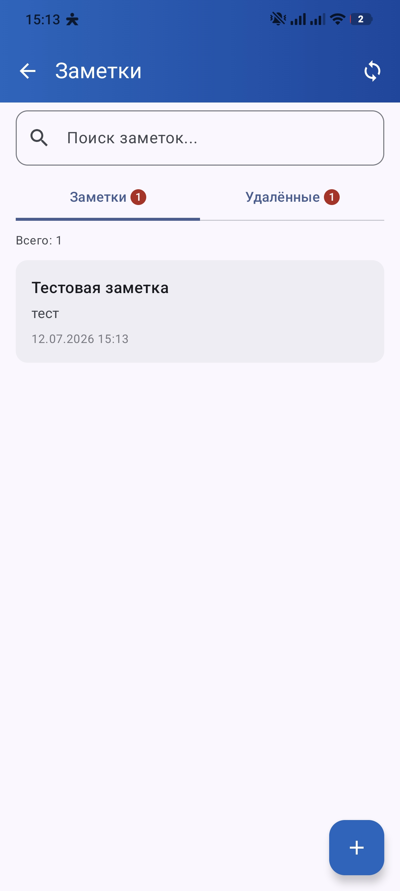<br>**Notes** |
| 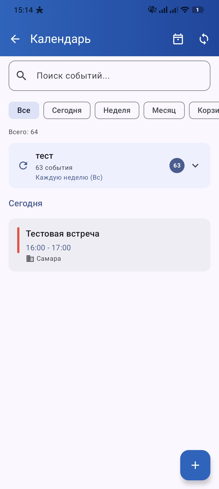<br>**Calendar (event list)** | 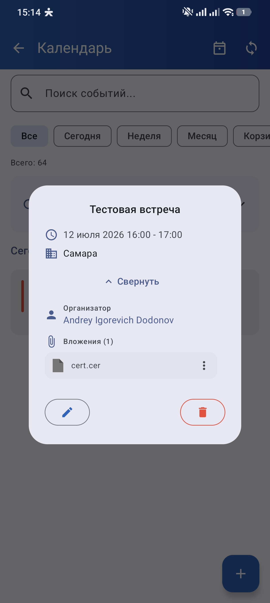<br>**Calendar event view** |

## ⬇️ Install

1. Open the [**Releases**](https://github.com/DedovMosol/IwoMailClient/releases) page and grab the latest version.
2. Download the APK for your device architecture (or `universal` if unsure):

   | ABI | For which devices |
   |-----|-------------------|
   | `arm64-v8a` | most modern phones (recommended) |
   | `armeabi-v7a` | older 32-bit ARM devices |
   | `x86_64` / `x86` | emulators and x86 tablets |
   | `universal` | a single APK for all architectures |

3. Allow installation from this source and install the APK.
4. On first launch, go through onboarding and add an Exchange account.

> The built-in updater checks `update.json` in the repository, picks an APK by ABI and prepares a rollback.

## 🖥 Requirements

| Parameter | Minimum | Recommended |
|-----------|---------|-------------|
| Android | 8.0+ (API 26) | — |
| RAM | 2 GB | 4+ GB |
| Storage | 50 MB | 100+ MB |
| CPU/ABI | armeabi-v7a / x86 | arm64-v8a / x86_64 |

- **Compile SDK:** 36 · **Target SDK:** 36 · **Java/Kotlin target:** JVM 17
- **APK:** universal + ABI splits for `armeabi-v7a`, `arm64-v8a`, `x86`, `x86_64`
- **Build:** JDK 17 required (JDK 11 minimum for Android Gradle Plugin 8.7.3)

## 🔌 Supported servers

| Server | Status |
|--------|--------|
| Exchange 2007 SP1/SP2 | ✅ Stable primary scenario |
| Exchange 2010/2013/2016 on-premise | 🟡 Architecturally supported via EAS/EWS, needs verification on the specific infrastructure |
| Office 365 / Exchange Online | 🟠 Limited: requires OAuth/Modern Auth, which is not yet implemented |
| IMAP/POP3 | 🧪 Beta: read/sync via JavaMail, without full parity with Exchange |

## 🔒 Security and compatibility

- **Conscrypt:** added for TLS 1.0/1.1 and compatibility with old Exchange 2007 installations.
- **Server certificates:** system, user and self-signed certificate support.
- **mTLS:** PKCS#12 client certificates (`.p12`/`.pfx`) with KeyManager caching.
- **Certificate Pinning:** stores SHA-256, CN/O and certificate dates per account.
- **Passwords:** `EncryptedSharedPreferences` (Android KeyStore, AES256-GCM) for the primary path; when the Keystore is unavailable — a PBKDF2-obfuscated store fallback with user notification and an optional fail-closed mode.
- **Alternate URL:** primary and backup Exchange URL with fallback on network errors and later auto-switchback.
- **Email body XSS protection:** `sanitizeEmailHtml` blocks `<script>`, plugin containers (`iframe`/`object`/`embed`/`applet`), event handlers, `meta http-equiv="refresh"`, `javascript:` and `data:text/html` URIs in all URL-context attributes; combined with a nonce CSP and `loadDataWithBaseURL(null, ...)` in the WebView for isolation from cross-origin context.

## ⚠️ Known limitations

- **OAuth 2.0 / Modern Auth:** not supported.
- **Office 365:** typically does not work without Basic Auth.
- **NTLM for EAS:** the EAS transport supports Basic Auth only (NTLMv2 applies to EWS operations only); the `/Microsoft-Server-ActiveSync` virtual directory must allow Basic Auth.
- **IMAP/POP3:** beta implementation, does not cover calendar, contacts, tasks, notes, Direct Push and EWS features.
- **S/MIME:** signing and encryption not implemented.
- **EAS 16.x:** explicitly not a target version of the project; the code's main range is EAS 12.x-14.1.

## 🧱 Tech stack

| Category | Technologies |
|-----------|------------|
| Language | Kotlin 1.9.22, Java 17 |
| Android | AGP 8.7.3, minSdk 26, targetSdk 36 |
| UI | Jetpack Compose, Compose BOM 2024.06.00, Material 3 |
| Async | Coroutines 1.7.3, Flow |
| Storage | Room 2.6.1 (`MailDatabase` v42), DataStore Preferences |
| Network | OkHttp 4.12.0, Conscrypt 2.5.2 |
| Protocols | EAS, EWS, JavaMail IMAP/POP3 |
| Background | WorkManager 2.9.0, Foreground Service, AlarmManager |
| Security | AndroidX Security Crypto, TLS/mTLS, Certificate Pinning |
| UI extras | Coil, Glance AppWidget |
| DI | Manual DI via `RepositoryProvider` |

## 🏗 Architecture at a glance

```text
UI Layer
  Jetpack Compose, Navigation, Theme, Localization
  MainScreen, Setup/Verification, Mail, Compose, Contacts, Calendar, Notes, Tasks, Updates
    ↓
Repository Layer
  AccountRepository, MailRepository, CalendarRepository, ContactRepository,
  NoteRepository, TaskRepository, SettingsRepository, AccountServerHealthRepository
  EmailSyncService, EmailOperationsService, FolderSyncService, AppFileCleanupService
    ↓
Protocol Layer
  EasClient facade
  EasTransport + EAS services + EWS client + IMAP/POP3 beta clients
    ↓
Persistence / Network
  Room MailDatabase v42, DataStore
  HttpClientProvider, NetworkMonitor, NtlmAuthenticator
    ↓
Background
  PushService, SyncWorker, OutboxWorker, reminders, notifications, watchdogs
```

Details: [Project Architecture](docs/ARCHITECTURE.md)

## 🛠 Build from source

Recommended production build path is Android Studio with JDK 17. The CLI commands below are a supplemental option when `JAVA_HOME` is configured correctly.

```bash
./gradlew assembleDebug
./gradlew assembleRelease
```

On Windows:

```powershell
.\gradlew.bat assembleDebug
.\gradlew.bat assembleRelease
```

## 📚 Documentation

- [Changelog RU](docs/CHANGELOG_RU.md)
- [Changelog EN](docs/CHANGELOG_EN.md)
- [Project Architecture](docs/ARCHITECTURE.md)
- [Privacy Policy](docs/PRIVACY_POLICY.md)
- [XmlPullParser migration plan](docs/XMLPULLPARSER_MIGRATION_PLAN.md)

## ♻️ Important: package rename

Version 1.6.1 changed the package from `com.iwo.iwomail` to `com.dedovmosol.iwomail`.

- Updating old APKs as a normal update is impossible: Android treats it as a different app.
- Reinstallation required: uninstall the old version, install the new one and re-add accounts.
- Before moving from the old package, export local contacts/data.

## 💬 Feedback

- **Telegram:** [@i_wantout](https://t.me/i_wantout)
- **Email:** andreyid@outlook.com
- **Issues:** [GitHub Issues](https://github.com/DedovMosol/IwoMailClient/issues)

## ⚖️ License

Licensed under the [GNU General Public License v3.0](LICENSE). Releases made before the switch to GPLv3 were published under MIT and remain under it.

---

© 2025-2026 DedovMosol

</div>
