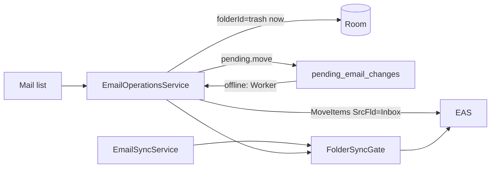
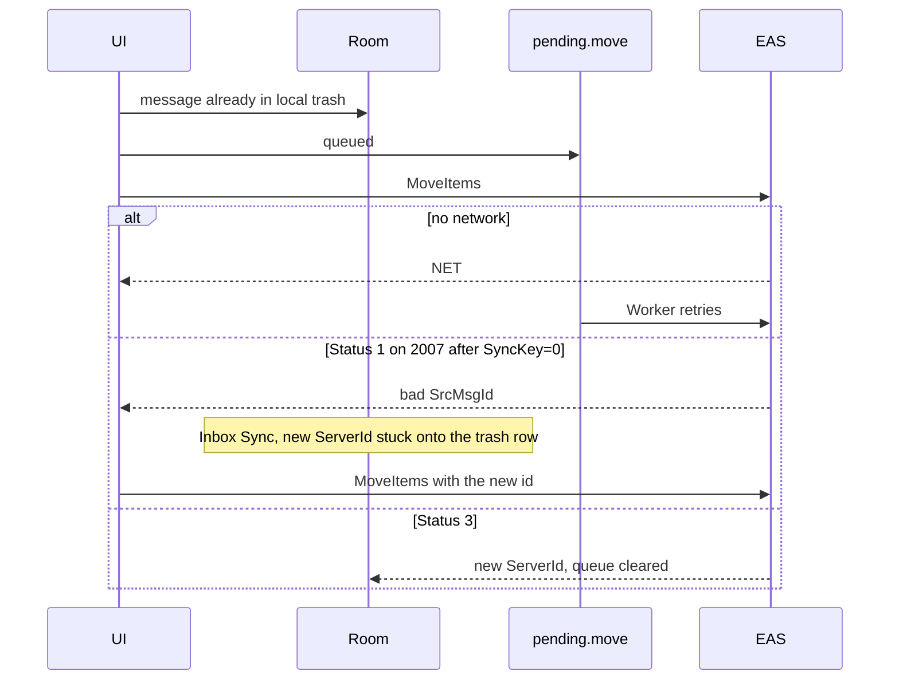

[Русская версия](ARCHITECTURE.md)

# Project Architecture

**iwo Mail Client** is an Android client for Microsoft Exchange (EAS/EWS) with beta IMAP/POP3 support.

**Version:** 1.7.0 (in preparation)
**Package:** `com.dedovmosol.iwomail`
**Gradle root:** `IwoMailClient`
**Android module:** `:app`

---

## 1. Project state v1.7.0

| Area | Value |
|------|-------|
| Application ID / namespace | `com.dedovmosol.iwomail` |
| Version | `versionName = 1.7.0`, `versionCode = 27` |
| SDK | `minSdk = 26`, `compileSdk = 36`, `targetSdk = 36` |
| JVM target | Java/Kotlin `17` |
| Kotlin | `1.9.22` (Compose compiler extension `1.5.8`) |
| AGP | `8.7.3` |
| Build tooling | Gradle `8.12`, KSP `1.9.22-1.0.17`, Kover `0.7.6` |
| UI | Jetpack Compose (BOM `2024.06.00`) + Material 3, Navigation Compose `2.7.6`, Coil `2.5.0` |
| DB | Room `2.6.1`, `MailDatabase` version `55` (14 entities), schema export enabled (`app/schemas`) |
| Network and background | OkHttp `4.12.0`, Conscrypt `2.5.2`, WorkManager `2.9.0`, DataStore `1.1.1`, Glance `1.1.1`, JavaMail (`android-mail`) `1.6.7` |
| Security | `security-crypto` `1.1.0-alpha06` (EncryptedSharedPreferences), `biometric` `1.1.0` |
| APK architectures | `armeabi-v7a`, `arm64-v8a`, `x86`, `x86_64` + universal APK |
| Tests | [Local JVM tests](../app/src/test/README.md) use JUnit, Robolectric, Compose UI and a fake Exchange. Tests against a real Exchange server are opt-in via environment variables. |
| Published release | GitHub Releases → `1.6.1` (`versionCode` 24); `1.7.0` is in preparation, no beta builds were published in between |
| Runtime model | Offline-first: Room + Flow → UI, background sync updates the DB |

The main production scenario is on-premise Exchange, especially Exchange 2007 SP1/SP2. IMAP retrieves folders and mail; POP3 retrieves Inbox mail. `ImapClient` contains folder mutation methods, but `FolderSyncService` allows changes from the UI only for Exchange accounts. There is no SMTP transport.

---

## 2. Application layers

```text
MainActivity (FragmentActivity) / MailApplication
  ├─ app start, Conscrypt, app lock (AppLockManager), notification channels, permissions
  ├─ mailto/share, iwomail://email, iwomail://widget, and reminder taps (calendar/task/flag: mailbox extra + id, navigate after account switch)
  └─ Compose content + AppNavigation; LockScreen on top of navigation while the app is locked

UI layer
  ├─ Jetpack Compose screens
  ├─ navigation, theme, localization
  ├─ screen subpackages: calendar, compose, contacts, emaildetail, emaillist
  └─ reusable components, animations, custom icons, rich-text widgets

Domain (domain/)
  └─ logic without UI: drafts, sending, conversation threads, flags, unsubscribe, read receipts, mail settings

Repository layer
  ├─ AccountRepository
  ├─ MailRepository
  ├─ CalendarRepository / TaskRepository / NoteRepository / ContactRepository / CategoryColorRepository
  ├─ SettingsRepository
  ├─ AccountServerHealthRepository
  ├─ EmailSyncService / EmailOperationsService / FolderSyncService / AppFileCleanupService
  └─ FolderSyncGate (one EAS Sync per folder) / FlagWriteTracker (optimistic flag writes) / PendingMailChanges (offline change queue)

Protocol layer
  ├─ EasClient facade
  ├─ EasTransport: EAS WBXML + EWS SOAP + Provision
  ├─ EAS feature services: mail, folders, contacts, calendar, tasks, notes, drafts, attachments
  ├─ EwsClient + NtlmAuthenticator
  └─ ImapClient / Pop3Client (beta, JavaMail)

Persistence / system layer
  ├─ Room: accounts, folders, emails, attachments, contacts, groups, signatures, notes, calendar, tasks, category colors, email change queue
  ├─ DataStore: UI settings, sync checkpoints, notification checkpoints, update settings
  ├─ data/security: PasswordStorage, EncryptedStoreProvider, AppLockManager, SecurityTelemetry
  ├─ AppLanguageCode: synchronous UI language cache (startup toasts, before DataStore collect)
  ├─ HttpClientProvider: shared OkHttp, TLS, mTLS, certificate pinning, Rfc6125HostnameVerifier
  ├─ FileProvider + MediaStore/Downloads integration
  └─ Glance widget + dynamic Android shortcuts and deep links

Background layer
  ├─ PushService: EAS Ping (Direct Push) foreground service
  ├─ SyncWorker: periodic and manual sync, cleanup, notification check
  ├─ OutboxWorker: offline outbox send
  ├─ PendingMailChangesWorker: sends stars, read state and moves queued without a connection
  ├─ ScheduledSendReceiver + ScheduledEmailWorker: scheduled send
  ├─ CalendarReminderReceiver / TaskReminderReceiver / FlagReminderReceiver / RescheduleRemindersWorker
  └─ BootReceiver / SyncAlarmReceiver / PushRestartWorker / ServiceWatchdogReceiver
```

How delete and sync meet (EAS 12.1–14.1):





---

## 2.1. UI state model (MVVM, introduced incrementally)

Historically the screens keep state directly in `@Composable` functions through `remember`/`rememberSaveable`/`LaunchedEffect`, without a ViewModel. This needs manual guards against recreation on rotation (`*Loaded`/`*Initialized` flags) and mixes presentation logic with rendering.

On top of that, a layer of **`androidx.lifecycle.ViewModel` + immutable `UiState` + `StateFlow`** is being introduced screen by screen. It touches only the presentation layer: the EAS/EWS protocol and Exchange 2007 SP1/SP2 compatibility do not change.

```text
Composable ──collectAsStateWithLifecycle──> StateFlow<UiState>  (ViewModel)
Composable ──event calls (vm.setX())──────> ViewModel ──> Repository (RepositoryProvider)
```

Principles:
- **UiState** is a `data class` with immutable fields and is the single source of data for the screen.
- **A ViewModel** survives rotation: state is kept without manual flags and extra DB reads.
- Coroutines run in `viewModelScope` (it outlives the composition), so DB writes and network operations are not cancelled by rotation.
- Dependencies come from `RepositoryProvider` through a `ViewModelProvider.Factory` (`provideFactory`); navigation arguments are passed to the factory. `RepositoryProvider` remains the DI mechanism.
- **One-shot events** (toasts, sound, navigation, easter egg) are not part of the state. They are sent through `Channel(Channel.BUFFERED)` → `receiveAsFlow()`, which the UI collects in a `LaunchedEffect`. A ViewModel does not depend on language or resources: it emits a semantic event and the UI localizes it.
- **Testability.** Repositories and the `CoroutineDispatcher` are passed through the constructor; the factory supplies the real implementations and a unit test supplies mocks. The system effects of `SyncCleanupViewModel` (push / sync rescheduling) are hidden behind the `SyncEffects` interface, so the tests run on JUnit + MockK.

**Wired to screens** (all ViewModels extend `ViewModel` and are created with `viewModel(factory = …)`):

- `SyncCleanupScreen` ↔ `SyncCleanupViewModel`/`SyncCleanupUiState` — account sync and cleanup settings. Dependencies: `AccountRepository` + `SettingsRepository` + `SyncEffects`. The `set*` operations are fire-and-forget. Test: `SyncCleanupViewModelTest`.
- `SearchScreen` ↔ `SearchViewModel`/`SearchUiState` + `SearchEvent` — search, selection, batch operations (delete, mark read, star). A query of 2+ characters is started from the UI after a 300 ms delay (`LaunchedEffect(query)`); the ViewModel cancels the previous search. Results live in the ViewModel and survive rotation; after process death the search is reset. Test: `SearchViewModelTest`.
- `NotesScreen` ↔ `NotesViewModel`/`NotesUiState` + `NotesEvent` — notes, trash, selection, search, auto-sync with throttling of the trash sync. The data source is reactive: `collectLatest(activeAccount)` + `combine`; the `isInitialLoadDone` flag lives in the state. Permanent delete, restore and empty-trash with progress are thin `suspend` functions of the ViewModel called by `DeletionController` (`ui/components/DeletionProgressBar.kt`). Test: `NotesViewModelTest`.
- `TasksScreen` ↔ `TasksViewModel`/`TasksUiState` + `TasksEvent` — tasks, trash, the `TaskFilter` filter (7 values: `ALL`, `TODAY`, `ACTIVE`, `COMPLETED`, `HIGH_PRIORITY`, `OVERDUE`, `DELETED`), two independent selection sets, search, auto-sync. `TaskRepository` only provides single `delete/restore/permanent` calls, so the batch `restoreTasks`/`deleteTasksPermanently` (with `onProgress`) loop inside the ViewModel. `initialFilter` is passed to the factory. Test: `TasksViewModelTest`.
- `UserFoldersScreen` ↔ `UserFoldersViewModel`/`UserFoldersUiState` + `UserFoldersEvent` — user folders (the list contains only EAS types `1` and `12`, sorted by name), selection, create, rename, delete and batch delete with progress in the state. `MailRepository` only provides single folder operations (`FolderSyncService` serializes them per account), so batch delete is a sequential loop in the ViewModel. Operations run in `viewModelScope` and survive rotation. Test: `UserFoldersViewModelTest`.
- `EmailListScreen` ↔ `EmailListViewModel`/`EmailListUiState` + `EmailListEvent` — the message list of a folder, of "Favorites" (`favorites`) and of "Today" (`TODAY_ALL`), filters (`MailFilter` with 5 values and `EmailDateFilter` with 5 values), selection, sync and batch operations: move to trash, move, restore, move to spam, mark read, flags, delete drafts, permanent delete. The current folder and the folder list for the move dialog come from one reactive source (`collectLatest(activeAccount)` + `combine`). Auto-sync runs only for "Drafts" and once per ViewModel instance (the `draftsSynced` flag). The network check (`NetworkMonitor`), the delete sound and message localization stay in the UI. Test: `EmailListViewModelTest`.
- `EmailDetailScreen` ↔ `EmailDetailViewModel`/`EmailDetailUiState` + `EmailDetailEvent` (the screen **core** is in the ViewModel) — message, attachments and folders in one `collectLatest(activeAccount)` + `combine` stream, from which the current-folder attributes (trash, sent, drafts) are derived. Inline images are loaded reactively and kept in the state, so rotation does not trigger a reload. Operations (refresh, move to trash, move, restore, mark unread, flag, answering and postponing the read-receipt request, unsubscribe, saving `.eml`, permanent delete) run in `viewModelScope`; business logic is delegated to `EmailDetailActions` (`ui/screens/emaildetail/`). The Composable keeps the WebView and body rendering, attachment launchers and file I/O, iCal parsing and meeting invitations. Test: `EmailDetailViewModelTest`.
- `ScheduledMailScreen` ↔ `ScheduledMailViewModel` + `ScheduledMailEvent` — the list of scheduled messages (a `StateFlow` built from `ScheduledSend.pending` and refreshed on `ScheduledSend.changes`), "send now", reschedule and cancel in `viewModelScope`. Receives `Application` and a `CoroutineDispatcher`. Test: `ScheduledMailViewModelTest` (Robolectric).

**The composer follows a different pattern.** `ComposeScreen` owns the fields and editor state. `LargeStateSaver` restores large bodies; `RetainScopeViewModel` keeps send and save operations running across rotation. `DraftSaver` handles draft persistence. `ComposeScreenOpenTest` opens the actual screen through `MainActivity`.

Dependencies: `lifecycle-viewmodel-ktx`, `lifecycle-viewmodel-compose`, `lifecycle-runtime-compose` (`2.7.0`).

---

## 3. Package structure

```text
com.dedovmosol.iwomail/
├── MainActivity.kt
├── MailApplication.kt
│
├── ui/
│   ├── MainScreen.kt
│   ├── MainScreenDrawer.kt
│   ├── Localization.kt
│   ├── navigation/AppNavigation.kt
│   ├── screens/
│   │   ├── SetupScreen.kt / VerificationScreen.kt / OnboardingScreen.kt / OnboardingPageEnter.kt / AddAnotherAccountScreen.kt
│   │   ├── LockScreen.kt — unlock with password/fingerprint
│   │   ├── EmailListScreen.kt / EmailDetailScreen.kt / ComposeScreen.kt / ComposeUtils.kt
│   │   ├── ContactsScreen.kt / CalendarScreen.kt / NotesScreen.kt / TasksScreen.kt
│   │   ├── SettingsScreen.kt (root) / SettingsScaffold.kt / SettingsCopy.kt / SettingsDialogs.kt
│   │   ├── SettingsAccountsScreen.kt / SettingsMailScreen.kt (mail + notifications) / SettingsSecurityScreen.kt
│   │   ├── MailSettingsSection.kt / MailAlertsSettingsSection.kt
│   │   ├── AccountSettingsScreen.kt / PersonalizationScreen.kt / SyncCleanupScreen.kt
│   │   ├── UserFoldersScreen.kt / UpdatesScreen.kt / AboutScreen.kt / SearchScreen.kt
│   │   ├── ScheduleSendDialog.kt / ScheduleSendTimes.kt / ScheduledMailScreen.kt / ScheduledEmailWorker.kt
│   │   ├── *ViewModel.kt — EmailList, EmailDetail, Notes, Tasks, Search, SyncCleanup, UserFolders, ScheduledMail
│   │   ├── calendar/ — AgendaView, MonthView, event dialogs, attachments, category colors UI, selection top bar
│   │   ├── compose/ — editor models, text/HTML helpers and inline attachments
│   │   ├── contacts/ — contact dialogs, list views and utilities
│   │   ├── emaildetail/ — attachments section, inline attachments, EmailDetailActions
│   │   └── emaillist/ — SwipeableEmailRow, SwipeRules, ThreadRows, row names, image previews
│   ├── components/ — HtmlBodyView, RichTextEditor, SendController, FlagMenu, EmailPrinter, AppPermissionDialog,
│   │                 WebViewRenderer (+ RendererRecovery), TouchDirectionLock, banners, dialogs, DeletionProgressBar
│   ├── theme/ — Theme, AppIcons, CustomTextToolbar
│   └── utils/ — animations, avatar colors, date formatting, ContextExtensions, LargeStateSaver, AppHaptics
│
├── domain/ — AttachmentLoader, DraftSaver, EditorInlineBudget, EmailThreads, FlagPresets, MailAlerts, MailPreferences,
│             OutgoingMail, ReadReceipts, RepositoryDraftStore, SendFailures, SentFolder, Unsubscribe
│
├── data/
│   ├── database/ — MailDatabase (Room, entities, migrations), DAOs (Daos.kt, *Dao.kt), EmailFlags.kt,
│   │               PendingEmailChangeEntity.kt (offline email change queue), PendingPimChangeEntity.kt (offline task and
│   │               note change queue), NotificationEmailSummary.kt
│   ├── model/ — AccountServerHealth.kt (server health state)
│   ├── security/ — PasswordStorage, EncryptedStoreProvider, AppLockManager, SecurityTelemetry
│   └── repository/ — repositories, sync and operation services, RepositoryProvider, caches, helpers
│                     (incl. FolderSyncGate.kt, FlagWriteTracker.kt, PendingMailChanges.kt, CategoryColorRepository.kt,
│                     RepositoryErrors.kt, EndpointClientCache.kt, CertificatePins.kt)
│
├── eas/ — EAS/EWS protocol layer and Exchange feature services (incl. MailFlag.kt, WbxmlParser.kt, ListUnsubscribe.kt, RssItems.kt)
├── imap/ImapClient.kt
├── pop3/Pop3Client.kt
├── shared/ — shared JavaMail interfaces, parsers and converters (MailClient, MailMessageParser, MessageToEntityConverter)
├── network/ — HttpClientProvider, NetworkMonitor, ConnectionFailure, Rfc6125HostnameVerifier
├── sync/ — PushService, workers, receivers, notifications, reminders:
│           AppForegroundTracker, BackgroundWork, InitialSyncController, PingFailurePolicy, PushRestartPolicy,
│           ScheduledSend/ScheduledSendReceiver, FlagReminderReceiver, PendingMailChangesWorker, ServerHealthNotifier,
│           MailNotificationChannels, SendNotifications, NotificationHelper, SyncHelper
├── update/UpdateChecker.kt
├── util/ — date/HTML/email/MIME/ICS/sound/deleted-id utilities, RemoteImages, EmlFiles,
│           EmailPrintDocument, AppShortcuts, AppCoroutines
└── widget/ — Glance widget (MailWidget, MailWidgetReceiver) and WidgetConfigActivity
```

---

## 4. Data and storage

### Room

`MailDatabase` contains 14 entity classes and 15 abstract DAO accessors (`accountDao`, `emailDao`, `folderDao`, `signatureDao`, `attachmentDao`, `contactDao`, `contactGroupDao`, `noteDao`, `calendarEventDao`, `taskDao`, `syncDao`, `categoryColorDao`, `pendingEmailChangeDao`, `pendingPimChangeDao`, `inboxSyncSnapshotDao`):

- **AccountEntity:** account type, URL and alternate URL, sync mode, certificate metadata (a separate pin for the alternate URL), draft mode, per-account sync and cleanup intervals.
- **FolderEntity:** Exchange/IMAP/POP3 folders and the SyncKey of each folder.
- **EmailEntity:** message metadata and body, read/importance, attachments marker, MDN fields, meeting message class, Internet Message-ID, draft `bcc` and `replacesServerId` (a draft that replaces a server draft edited offline), follow-up flag (`flagged`, `flagCompleted`, `flagStartDate`, `flagDueDate`, `flagReminder`), `listUnsubscribe`/`listUnsubscribeOneClick`, draft `requestReadReceipt`/`requestDeliveryReceipt`, `conversationId` (EAS 14.0+).
- **AttachmentEntity:** message attachments, local download state, inline CID metadata.
- **ContactEntity / ContactGroupEntity:** local and Exchange contacts, groups, favorites, usage counters.
- **SignatureEntity:** HTML signatures.
- **NoteEntity:** Exchange notes with a local trash flag.
- **CalendarEventEntity:** calendar events, meetings, recurrence fields, exceptions, attachments JSON, online links, meeting request IDs.
- **TaskEntity:** task fields, deadlines, priority, reminders, owner/assignee, local trash flag.
- **CategoryColorEntity** (`category_colors`, primary key `accountId` + `nameKey`): per-account Outlook category colors (`serverColor` from the Master Category List on Exchange 2010+, `userColor` set in the app).
- **PendingPimChangeEntity** (`pending_pim_changes`, introduced in DB version 51): offline task and note changes — `pendingCreate` (added in 52), `pendingUpdate` and `pendingTrash`, `kind` (TASK/NOTE), `serverSubject`, `version`. The only foreign key is to `accounts` (cascade), for the same reason as the email queue.
- **PendingEmailChangeEntity** (`pending_email_changes`, DB version 50): email changes made without a connection that the server has not accepted yet — `flag` and/or `read`. The value itself is not stored: the current one from `emails` is sent, so several offline edits go out as one result. There is deliberately no foreign key to `emails`: some paths rewrite messages with REPLACE (DELETE + INSERT), and a cascade would drop the pending edit. The foreign key to `accounts` uses CASCADE. `INSERT OR REPLACE … COALESCE` is used instead of UPSERT because SQLite on Android 8 is version 3.18 and has no UPSERT.

The current DB version is **55**. The registered migrations cover `23→55` (`MailDatabase.ALL_MIGRATIONS`, 32 migrations, one per version). A missing upgrade migration recreates the DB only in **debug** builds (`fallbackToDestructiveMigration()` under `BuildConfig.DEBUG`); in release it fails explicitly when the DB is opened. A downgrade (installing an older APK) always recreates the DB (`fallbackToDestructiveMigrationOnDowngrade()`), and server data is resynced.

Widget hot paths use dedicated lightweight projections instead of full entities:

| Use case | DAO projection / query shape |
|----------|------------------------------|
| Recent unread Inbox messages | `WidgetRecentEmailSummary` without `EmailEntity.body` |
| Current/upcoming calendar event | `WidgetCalendarEventSummary` without body, attendees and attachments JSON |
| Next task title | `WidgetTaskSummary` without the task body |

Migration 41→42 (DB version 42) added indexes for the home-screen widget paths: `emails(read, dateReceived)`, `folders(type)`, `tasks(complete, isDeleted, dueDate, subject)`, `calendar_events(isDeleted, startTime, endTime)` and `calendar_events(isDeleted, endTime, startTime)`.

### DataStore

`SettingsRepository` stores UI preferences, the default draft mode, update-check settings, sync checkpoints, notification checkpoints and per-account cleanup and non-email sync timestamps.

### Secure storage

`AccountRepository` stores passwords through `data/security/PasswordStorage`, which gets its store from `EncryptedStoreProvider`: `EncryptedSharedPreferences` by default. If Android Keystore is unavailable or corrupted, it falls back to `ObfuscatedSharedPreferences` (XOR with a PBKDF2-derived key, see section 8) instead of plaintext. The app-lock password hash (`AppLockManager`) uses the same provider.

---

## 5. Exchange protocol architecture

### EasClient

`EasClient` is the facade used by the repositories. It owns the stable `DeviceId` (derived from the user name and the account suffix), the shared OkHttp client, `EasTransport`, `EasVersionDetector`, the EAS feature services and `EwsClient`.

### EasTransport

`EasTransport` is responsible for WBXML generation and parsing, `PolicyKey` handling, the retry after HTTP `449` through Provision (two-phase, under `provisionMutex`), EWS delegation to `EwsClient` (NTLM, switching to Basic only if explicitly offered in an HTTP 401) and shared error normalization.

`EasVersionDetector` picks the highest common version from `14.1`, `14.0`, `12.1`, `12.0`; Exchange 2007 SP1 reports `2.5, 12.0, 12.1`, so `12.1` is selected for it.

### EWS

EWS requests use SOAP and `RequestServerVersion="Exchange2007_SP1"` by default (`EwsClient.VERSION_2007`). EWS is used where EAS 12.x is incomplete or unreliable: notes, many task paths, server drafts, calendar details, meetings, exceptions and attachments.

The NTLM handshake (Type1 → Type2 → Type3) runs on a dedicated OkHttp client with `ConnectionPool(1)` and is serialized by a lock (`ntlmLock`): Type1 and Type3 share one TCP connection and cannot be interleaved with parallel EAS/EWS traffic, because NTLM authenticates the connection, not the request.

MIME body extraction (`MimeHtmlProcessor.extractHtmlFromMime`) splits the message by multipart boundaries per RFC 2046 and recurses into nested parts; a regex fallback covers single-part MIME.

### IMAP/POP3 (beta)

`ImapClient` and `Pop3Client` implement `shared.MailClient` (`connect`, `disconnect`, `getFolders`, `getEmails`) through JavaMail. Folders are opened read-only (`Folder.READ_ONLY`) and the latest `limit` messages are read. IMAP takes read/star state from the `SEEN`/`FLAGGED` flags and can also create, rename and delete folders. POP3 works with INBOX only and always returns `read=false`, `flagged=false`. The outgoing server (`outgoingServer`/`outgoingPort`) is only stored in `AccountEntity`: there is no SMTP transport in the code, and the empty `smtp/` directory contains no sources.

---

## 6. Main runtime flows

### Startup

1. `MailApplication.onCreate()` installs Conscrypt, registers `ServiceWatchdogReceiver` dynamically and starts `AppForegroundTracker` (`ProcessLifecycleOwner`).
2. `AppLockManager.init()` evaluates the lock state (cold start with a password set = locked); the app locks again when the whole process goes to the background (short trips to system pickers excepted).
3. Notification channels are created for sync, sync status, calendar and task reminders, outbox, scheduled send, updates and connection status. Mail channels are per account (`MailNotificationChannels`: a channel group per account with a "New emails" channel; the "Important senders" channel of the betas is deleted at startup). `SendController.shared` is created here too, on the main thread before the first composition.
4. Stale temp files (including `LargeStateSaver` files older than 24 h in `cacheDir`) and old attachments are removed; duplicate message records are cleaned once; a legacy outbox queue from earlier versions is drained; if anything is left in `pending_email_changes`, `PendingMailChangesWorker` is enqueued.
5. Periodic sync is scheduled.
6. `PushService` is started when at least one Exchange account is in Push mode; server health is observed for connection-loss notifications (`ServerHealthNotifier`); dynamic app shortcuts are kept up to date.
7. `MainActivity` handles permissions and external intents, then starts Compose navigation.

### Account setup

1. `SetupScreen` collects the account data.
2. Exchange accounts go through `VerificationScreen`.
3. Verification connects to the server and can send a test message.
4. Passwords are passed in memory through `VerificationSecrets` and then persisted by `AccountRepository`.
5. IMAP/POP3 accounts are beta accounts with simpler validation.
6. Server certificates, self-signed certificates, client `.p12/.pfx` certificates and pin metadata are handled through `HttpClientProvider` and the account fields.

### Mail sync

1. `FolderSyncService` syncs folders and serializes folder operations per account (a `Mutex` per account).
2. `EmailSyncService` syncs system and user folders with full and incremental strategies.
3. `MailRepository` exposes the UI-facing methods and delegates the heavy logic to the services.
4. `EmailOperationsService` handles move, delete, permanent delete, mark read, flag and read-receipt flows (Exchange sends the read receipt itself when the message is marked read, declining uses EWS `SuppressReadReceipt` before marking read). A move (including to trash) is EAS MoveItems first, a folder Sync only on `MOVEITEMS_ALL_FAILED` / Status=1 (EAS 12.1, Exchange 2007 SP1).
5. `OutboxWorker` retries offline outgoing messages when the network returns. Each queued message carries a stable `ClientId`/`Message-ID` reused across retries: on EAS 14+ the server discards a retry with the same `ClientId` after a lost response ([MS-ASCMD] `SendMail`); on Exchange 2007 (EAS 12.1, raw-MIME `SendMail` without `ClientId`) the stable Message-ID is only a best-effort identity.

#### One EAS Sync request per folder (`FolderSyncGate`)

The SyncKey ([MS-ASCMD] Sync) is a chain: every response issues the next key. Two requests with the same key (the sync loop and a star/read change) make the client and server keys diverge; the next request gets Status 3 and the folder is resynced from scratch.

`FolderSyncGate.withFolder(folderId)` is a process-wide per-folder `Mutex` (`SyncWorker` and `PushService` create separate service instances, so the gate is an `object`). It is used by:

- `EmailSyncService.syncEmailsEas`: each loop iteration (request, batch processing by the local function `processSyncBatch`, SyncKey save) and the initial `SyncKey=0` request;
- `EmailOperationsService`: flag writes (`setFlag`/`toggleFlag`/`retryPendingFlag`), `markAsRead` and `markAsReadBatch` (through `sendReadToServer`), and batch permanent deletion (`deleteExchangeFolder`);
- `MailRepository.deleteDraft`: selection verification and deletion using the current EAS key or a known EWS ItemId.

Inside the gate the SyncKey is re-read from the DB, so the loop continues from a key advanced by a local change. The mutex is not reentrant: the same folder's gate must not be taken inside the block.

There is no separate full sync of Sent Items. After sending, `refreshSentFolder` runs up to three regular folder syncs; the regular sync itself recovers from a stale key (Status 3/12) with a full resync through the gate and the `reconcileSentAfterFullResync` reconcile. On any other error (no connection, server failure) it stops: a full sync without a connection would only reset the key.

Only the new-account check (`VerificationScreen.findTestEmail`) stays outside the gate: it uses a temporary `EasClient` before the account is saved, writes nothing to the DB, and no other sync of that account exists yet.

#### Optimistic flag writes (`FlagWriteTracker.shared`)

A star/flag change is written to the DB immediately, then sent to the server as a Sync Change.

- Each tap gets a ticket; only the latest tap is sent to the server and only its outcome settles the DB. Responses to earlier taps do not flip the star back.
- A server rejection rolls the flag back to the last flag **confirmed by the server**, not to the snapshot before the tap (the snapshot may itself be the optimistic value of the previous tap).
- No network or no response keeps the local value.
- If the local value waits in the queue (`pending_email_changes`) and the record about this message was forgotten after a process restart, the tracker marks the flag `unconfirmed` and takes an assumed server value (`serverGuess`, the opposite of the local one) as the last confirmed one, so a rollback does not leave a rejected flag.
- A sync response requested before or during a local flag write does not overwrite the local flag: `applyServerFlag` compares the request time (`requestedAt`) with the time of the last write, and while a write is in flight it only remembers the server flag as confirmed.
- Tracker entries without active writes are evicted after 10 minutes idle.
- Lock order is `FolderSyncGate`, then the tracker's lock. The server part runs in `NonCancellable`, so leaving the screen does not cut a request halfway.
- A rejection returns `RepositoryErrors.FLAG_REJECTED`; `EmailListViewModel` and `EmailDetailViewModel` turn it into an error event and the UI shows a localized toast.

#### Offline changes (`pending_email_changes` → `PendingMailChangesWorker`)

Only an explicit rejection of the change itself rolls it back (`isChangeRejected`): `Change Status=N` (except 8), or collection Status 4/6/7. Status 8 ("object not found") is not a rejection: Exchange 2007 answers a Change with it right after a `SyncKey=0` reset, until the message is sent again (verified on the server); the change waits in the queue. With no key (`"0"`, the folder waits for a full sync) the change also waits: getting a key with `Sync(SyncKey=0)` would reset the sync state on the server. A stale SyncKey (3), a changed folder hierarchy (12), a server error (5), HTTP errors and no connection keep the local value, mark it in `pending_email_changes` and return success: the star does not disappear, and a message read offline does not become unread again.

- `PendingMailChangesWorker` is unique work (`ExistingWorkPolicy.KEEP`) with the `NetworkType.CONNECTED` constraint, exponential backoff starting at 30 s and at most 20 attempts. It sends through the same path as a tap (`EmailOperationsService.retryPendingFlag`/`retryPendingRead` via `PendingMailChanges.flush`, which also picks up edits made during the run).
- `KEEP` is deliberate: a failed send inside the worker enqueues nothing again, so there is no loop without a pause; leftovers are retried with backoff. After 20 failed attempts the queue stays in the DB, and `enqueueIfPending` is called from `SyncWorker` and `MailApplication`.
- While a field waits, sync does not overwrite it: `EmailDao.updateReadStatusFromServer` and `updateFlagFromServer` (through `EmailFlags.saveServerFlag`) contain a `NOT EXISTS` condition on the queue.
- On a ServerId change of the message (EAS 12.1 after `SyncKey=0`) the queue entry moves with it: `PendingEmailChangeDao.rename`.

#### ServerId renumbering on Exchange 2007

Exchange 2007 (EAS 12.1) gives ServerIds in the order the sync state sends the messages (`2:1`, `2:2`…). After `SyncKey=0` the numbers are given again: with no mailbox changes the layout is the same, but a new or deleted message shifts the numbers of every message after it (`LiveServerIdProbeTest`). A DB row left from the old layout then names another message with its id. Protection:

- **Fewer resets.** `syncWithRetry` does a full resync only when the sync state is broken (`needsFullResync`: `INVALID_SYNCKEY`, Status 3/12), not on "sync already running" or a server error. The star and read state never send `Sync(SyncKey=0)` when the key is `"0"`.
- **Add checked against the row.** `processNewEmailsBatch`: an Add with the id of an existing row but about another message (`EmailSyncService.sameServerItem`: the server's Message-ID, otherwise subject, sender and time ±2 s) rewrites the row (`replaceRemappedRows`): metadata, flag and attachments come from the server, waiting edits are dropped. The body and Message-ID come from the row of the same message in the same batch (the numbers shifted); otherwise the body loads on open.
- **Only the message's own body.** The ItemOperations response carries the item's subject and `DateReceived` (`EmailBodyResult.itemSubject`/`itemDateReceived`). `loadEmailBody` and `prefetchEmailBodies` compare them with the row (`bodyBelongsTo`); on a mismatch the body is not written, the error is `ITEM_MISMATCH`, the folder is marked (`markServerIdsStale`) and its next sync is a full one (at most once per 15 minutes per folder). Load results (body, attachments, unsubscribe) are written in a transaction and only if the row is still about the same message (`writeIfSameItem`).
- **Message screen.** `EmailDetailViewModel` remembers the opened message. If the row is gone or now describes another message, the screen does not show it, looks for the same message under a new id (`MailRepository.findSameEmailId`, waiting up to 30 s for a running folder sync) and opens it (`EmailDetailEvent.Reopen`); if nothing is found it says "Email deleted on server".

#### Permanent delete

1. Manual deletion carries the `MailDeleteSelection` captured in the confirmation dialog. The repository checks it against lightweight `EmailServerRef` rows without bodies, in chunks of up to 500 IDs, and processes changes through the last EAS Sync page. A full enumeration invalidates the old selection because Exchange can renumber ServerIds. A database checkpoint marks an unfinished enumeration, so resuming it after a restart does not authorize deletion of the earlier selection.
2. Under `FolderSyncGate` the app rechecks the account, folder, ServerId and message fields, skipping pending moves. Delete uses the current key and `GetChanges=0`. It neither looks up another ID by subject nor replays Delete after a key reset.
3. `EasDeleteResponse` scopes acknowledgement to each item. The new key is saved atomically with removal of acknowledged local rows. Rejected items and their queued changes remain. Item-level status 8 means that particular item is already absent, not that the entire batch succeeded.
4. Permanent deletion never falls back to an EWS subject lookup. A draft with a known EWS ItemId still uses exact-ID EWS deletion. A draft with an EAS ServerId can be deleted from Drafts with a confirmed selection and the current key. Deleting one draft does not follow historical IDs to delete earlier versions. Exchange 2007 can move an EAS-deleted draft into Deleted Items instead of purging it.
5. Auto-cleanup stores each folder's sync epoch with its candidates and checks it under the same gate. An epoch change or a legacy baseline starts a fresh waiting period instead of reusing saved numeric IDs. Move to Trash does not permanently delete items, including Search results from Deleted Items or Drafts.

#### Orphan detection after a full resync

Lightweight DAO projections avoid loading full `EmailEntity` objects for large folders:

| Use case | Projection |
|----------|------------|
| Sent reconcile after a full resync (`reconcileSentAfterFullResync`) | `List<String>` ids only |
| Generic folder reconcile after a full resync (`reconcileGenericFolderAfterFullResync`) | `List<String>` ids only |
| ServerId content matching after a `SyncKey=0` reset (`resolveEmailIds`) | `EmailDedupInfo` |

The Drafts reconcile (`reconcileDraftsAfterFullResync`) keeps full `EmailEntity` objects because body and `bodyType` migration is required.

### Calendar, tasks, notes, contacts

1. Repositories own the local Room state and the UI operations.
2. EAS/EWS services own the protocol details.
3. Calendar and task reminders are scheduled through Android receivers and workers.
4. Local `isDeleted` flags and `DeletedIdsTracker` prevent deleted items from reappearing while the Exchange state catches up.
5. Calendar attachments are stored as JSON metadata in `CalendarEventEntity.attachments`; file bytes are downloaded only on demand.
6. Recurring series store attachment metadata on the master event or exception, and virtual occurrences reuse it instead of duplicating the data.
7. Permanent calendar deletion requires server success first: local deletion and trash clearing happen only after a confirmed EAS/EWS delete.
8. When an attendee deletes a meeting, `MeetingResponse` or EWS `DeclineItem` is sent before the delete so that the Calendar Repair Assistant does not bring the meeting back.

#### Offline task and note changes (`pending_pim_changes`)

An edit of a task (done, subject, dates) or note and a move to trash made without a connection are saved on the device and queued in `pending_pim_changes`; the same `PendingMailChangesWorker` sends them (one unique work, `NetworkType.CONNECTED`, exponential backoff).

- **When to defer** (`OfflineWrites`): no network — the server is not contacted at all (no timeout, no wasted battery); the request did not get through — a connection-level `[NET:…]` tag, HTTP 5xx (`isConnectionLevelError`), or the network dropped during the request (the EWS path on Exchange 2007 returns an untagged error on a drop). A server rejection is an error, as before.
- **No value is stored**: the current state of the task or note is sent, so several edits go out as one result. `serverSubject` is the subject before the first offline edit: EWS on Exchange 2007 finds a task by subject. `version` grows with each edit and the mark is cleared only for the same version, so an edit made during the send is not lost.
- **Order**: an online edit behind a queued edit of the same item is queued too; otherwise the server would get the older version last.
- **Protocol is chosen at send time**: the same `EasClient.updateTask`/`deleteTask`/`updateNote`/`deleteNote` as online (EAS 14+, EWS on Exchange 2007).
- **Sync** does not overwrite an item with a pending edit, does not treat it as a duplicate and does not restore it from trash. A server-side delete still wins. After sending, one sync per account and kind, not per item: it picks up new ServerIds (move to Deleted Items, UpdateItem on Exchange 2007).
- **Trash**: restoring before the send is device-only; the server is not touched. Permanent delete, empty trash and reset ("Reset and resync") send the queue first; without a connection they fail with `PENDING_CHANGES_NOT_SENT` and no data is lost.
- Task assignment (an email to the assignee) is not deferred offline; it is an error.
- UI: the `SavedOffline` event closes the dialog and shows "Saved on the device. It will be sent to the server when the connection is back".
- Creating a task or note offline saves a local item marked `pendingCreate`. The queue handler creates it on the server when connectivity returns. This differs from assigning a task to someone, which requires a connection.

### Notifications

1. `PushService` receives changes from EAS Ping.
2. `SyncWorker` also checks notifications during periodic and manual sync.
3. Both use `NotificationHelper.notificationMutex` to avoid duplicate notification races.
4. Notification queries use lightweight projections (`NotificationEmailSummary`) and bounded action batches (up to 20 messages shown, up to 25 messages per "mark read" action).
5. Mail notifications go to per-account channels (`MailNotificationChannels`); sound, importance and Do Not Disturb are set per account in system settings. Quiet hours (`domain/MailAlerts`, a global setting) make notifications silent with no exceptions. The same section has the "Haptic feedback" switch (`AppHaptics`): vibration is marked as touch feedback (`USAGE_TOUCH` on Android 13+, `USAGE_ASSISTANCE_SONIFICATION` below) and ticks are at most one per 50 ms.
6. `ServerHealthNotifier` posts one notification per account when the connection to the server is lost; flag reminders are delivered by `FlagReminderReceiver`.

### Home-screen widget

1. `MailWidget` uses `SizeMode.Responsive` with 12 fixed sizes from `WidgetLayout.kt`. Unlike `SizeMode.Exact`, this set bounds the number of `RemoteViews` variants sent to the launcher.
2. Each `provideGlance` session uses one snapshot loader for all its sizes. It reads Room and settings on `Dispatchers.IO` with `applicationContext`, using lightweight projections (see section 4).
3. Under `widgetUpdateMutex`, `updateMailWidget(context)` signals running sessions to refresh and calls `updateAll()` to start sessions as needed. A session also observes App Lock. It masks details in its current state before reloading from Room and ignores late snapshots. The launcher displays the result once it receives the new `RemoteViews`.
4. Actions that open `MainActivity` use distinct `data` URIs and pass parameters in extras. `Intent.filterEquals` ignores extras. Manual sync goes through a separate broadcast, `SyncAlarmReceiver.ACTION_SYNC_NOW`, which delegates to `SyncWorker`.
5. `widgetSpec` uses width, height and the system font scale. Avatar slots and the sync label depend on available width, and the number of rows depends on height. Message times use `isSameLocalDay`: today shows the time, otherwise the date.
6. **Active account.** Mail, the unread count, events, tasks and notes are loaded by `accountId` for the active account, or the first if none is marked active. When there is room for avatars, the active one has a white ring and opens its mail. Tapping another avatar runs `SelectWidgetAccountAction`, which switches accounts without opening the app and ignores an account that has already been removed. Both the observer in `MailApplication` and the action itself request a widget update.

### Updates and rollback

1. `UpdateChecker` reads `update.json` from GitHub.
2. The APK URL is selected by device ABI with a universal fallback.
3. Downloads use shared OkHttp clients with long timeouts (the update channel uses system CAs and `MODERN_TLS`).
4. Install intents use `FileProvider`.
5. On Android 10+ rollback preparation copies the APK to `Downloads/iwomail rollback` through MediaStore. On Android 8–9 the code attempts a direct write, but the app does not request permission to write to shared Downloads. Rollback is not an in-place update: the user uninstalls the app and its local data, then installs the saved APK.

---

## 7. Background components

| Component | Responsibility |
|-----------|----------------|
| `PushService` | Direct Push foreground service (`foregroundServiceType="dataSync"`): adaptive EAS Ping heartbeat (starts at 480 s, bounds 120–1800 s, step 60 s; on Ping `Status=5` the server-supplied `HeartbeatInterval` is accepted within these bounds per [MS-ASCMD], otherwise the heartbeat is halved), per-account jobs; the reaction to failure series is defined by `PingFailurePolicy` |
| `SyncWorker` | Periodic and manual sync, notification check, auto-cleanup, `PushService` health check, enqueueing `PendingMailChangesWorker` (`enqueueIfPending`); a concurrent run is skipped (`doWorkMutex.tryLock()`) |
| `OutboxWorker` | Offline outbox send (unique work `outbox_send`, up to 10 attempts) |
| `PushRestartWorker` | Push restart after failures |
| `BootReceiver` | Start sync and push after reboot or package replacement |
| `SyncAlarmReceiver` | `AlarmManager` fallback for aggressive OEM ROMs; also handles manual sync (`ACTION_SYNC_NOW`) |
| `ServiceWatchdogReceiver` | `PushService` watchdog on screen, unlock and power events. **Registered dynamically in `MailApplication`** (`ContextCompat.registerReceiver` + `RECEIVER_NOT_EXPORTED`): `SCREEN_ON`/`USER_PRESENT`/`POWER_CONNECTED` are implicit broadcasts that are not delivered to manifest receivers on API 26+. The restart goes through `PushService.requestRestart`: exact alarm + `getForegroundService` + a WorkManager fallback, under the rate limiter `PushRestartPolicy` (a circuit breaker with exponential delay; when it opens, recovery is handed to `SyncWorker`) |
| `MailNotificationActionReceiver` | Notification actions for mail (mark read is delegated to `MarkEmailReadWorker`) |
| `CalendarReminderReceiver` | Calendar reminder actions (reminder, mark read, snooze for 5 minutes) |
| `TaskReminderReceiver` | Task reminder actions (completion enqueues `MarkTaskCompleteWorker`) |
| `FlagReminderReceiver` | Reminders for flagged messages (`tasks:ReminderTime`); alarms only for the nearest 50 reminders (`MAX_SCHEDULED`), the flag is re-checked in the DB when the alarm fires |
| `ScheduledSendReceiver` | Exact alarm for a scheduled message: starts the send on time (`ScheduledSend`) |
| `ScheduledEmailWorker` | Sends a scheduled message (`ui/screens`, class name kept for already enqueued work); also the WorkManager backup for the exact alarm; temporary errors are retried (up to 8 attempts), otherwise the message goes to Drafts with a notification |
| `MarkEmailReadWorker` | Unique work that marks a message as read (up to 3 retries) |
| `MarkTaskCompleteWorker` | Completes tasks from notifications; a server error is retried (up to 10 attempts with exponential backoff) instead of being swallowed |
| `PendingMailChangesWorker` | On reconnection, sends mail edits (flag, read state, move) from `pending_email_changes` and task/note changes from `pending_pim_changes`. `OutboxWorker` handles outgoing messages themselves. |
| `RescheduleRemindersWorker` | Rebuilds calendar, task and flag reminder alarms after reboot or update |
| `MailWidgetReceiver` | Glance widget receiver (`widget/MailWidget.kt`) |

The manifest declares `PushService`, WorkManager's `SystemForegroundService` (`dataSync`), `FileProvider`, the receivers `BootReceiver`, `SyncAlarmReceiver`, `CalendarReminderReceiver`, `TaskReminderReceiver`, `ScheduledSendReceiver`, `FlagReminderReceiver`, `MailNotificationActionReceiver`, `MailWidgetReceiver`, and the activities `MainActivity` and `WidgetConfigActivity`. WorkManager workers are not declared in the manifest. Among the receivers only `BootReceiver` and `MailWidgetReceiver` are exported; the other receivers are `exported="false"`.

---

## 8. Security and network

`HttpClientProvider` centralizes OkHttp creation to avoid connection and thread pool leaks.

Supported network and security modes:

- normal system trust: system root certificates and, for Exchange clients, additionally user-installed certificates (`AndroidCAStore`), which self-signed Exchange 2007 SP2 setups need;
- accept-all mode for legacy and self-signed environments;
- a custom server certificate (`certificatePath`);
- a PKCS#12 client certificate with mTLS;
- certificate pinning with a saved SPKI SHA-256 and metadata (a separate pin for the alternate URL). `HttpClientProvider.trustModeOf` picks the mode: `ACCEPT_ALL` → `IMPORTED` (certificate file, the pin is checked after chain validation) → `PINNED_KEY` → `SYSTEM`;
- trust by fingerprint (TOFU, `PINNED_KEY`): when the system cannot verify the certificate, `fetchServerCertificate` gets it by a handshake without credentials (STARTTLS/STLS on 143/110) and returns the system verdict (`SystemTrust`). `ServerCertificateDialog` shows the fingerprints; Trust pins the key, and `createPinnedKeyTrustManager` accepts only that key, without CA, name or expiry checks. If the system trusts the certificate, the dialog offers the system check (`AccountRepository.useSystemTrust`) instead of a pin. An SSL setup error in `PINNED_KEY` and `IMPORTED` modes fails client creation (fail-closed);
- the Conscrypt provider for legacy TLS compatibility; Exchange clients use `ConnectionSpec.COMPATIBLE_TLS` (TLS 1.0–1.3 in one handshake), the update channel uses `MODERN_TLS` and system roots only (`getSystemTrustOnlyClient`).

Hostname verification: with an imported server certificate (`certificatePath`) the client uses `Rfc6125HostnameVerifier` (SAN dNSName/iPAddress per RFC 6125, CN fallback only when the certificate has no SAN, which is common for Exchange 2007 self-signed certificates); accept-all mode disables verification by the user's choice; otherwise OkHttp's default verifier is used.

Cleartext traffic is disabled globally (`res/xml/network_security_config.xml`: `cleartextTrafficPermitted="false"`, only system certificates trusted in `base-config`). Exchange (EAS over OkHttp) is therefore HTTPS-only: the setup screen does not offer HTTP for Exchange accounts and forces `useSSL=true` on save. IMAP/POP3 run through JavaMail. `shared/MailSessionProperties.forAccount` builds the session properties: non-SSL ports require STARTTLS/STLS, the server name is checked (except with accept-all and a pinned key), and TLS 1.0 and 3DES are allowed last (Exchange 2007 on 993/995). Trust is the same as for EAS: `HttpClientProvider.mailSslContext` builds an `SSLContext` with the same TrustManager and client certificate, passed as an object in `ssl.socketFactory`. `socketFactory.fallback=false` is always set: otherwise JavaMail silently connected with the default factory when ours refused, and any certificate from a device CA bypassed the pin.

`AccountRepository` caches `EasClient` per account (`EndpointClientCache`) and invalidates the cache when certificate or server settings change. Switching to the alternate Exchange URL is supported for connection-level errors, with a later probe and switch back to the primary.

### Attachment download

An attachment is streamed to a file and never read into memory whole (`EasAttachmentService.downloadAttachmentToFile`, `EasClient.downloadMailAttachmentToFile`). Order:

1. ItemOperations Fetch with `MS-ASAcceptMultiPart: T`: the file arrives as a separate binary part of the response ([MS-ASCMD] MultiPartResponse), and `EasMultipart.Reader` checks the part header and copies the part to the file. The response is read and closed inside `EasTransport.openEasCommand` in the same `withContext`, so coroutine cancellation leaves no open connection.
2. On EAS 12.x, GetAttachment as POST (Exchange 2007 rejects GET with 501; 14.0+ has no such command). It is skipped after Status 11: the server limit is shared.
3. EWS: the message is found by Message-ID or subject, folder and date (`EwsMailLocator`), the attachment by name, and among duplicates by Content-ID (`EwsAttachments.match`; size is not used because EWS 2007 has no `t:Size`). `EwsClient.executeStreaming` uses the same authentication path as other EWS calls and hands the stream to `EwsAttachmentContent`, which decodes base64 on the fly. A cut inside `Content` is an error, `<t:Content/>` is an empty file.

Errors are `AttachmentErrors` codes (TOO_LARGE, NOT_FOUND, NO_SPACE, TOO_LARGE_FOR_MEMORY); network, 401, 403 and out-of-space errors are not retried. The message screen writes to a temporary `att_*.part` and renames it on success, and the file is deleted on cancellation. Save: on Android 10+ `DownloadsSaver` (MediaStore, `IS_PENDING`), on 8–9 the SAF system dialog; on failure the created empty document is deleted. In-memory download (`downloadAttachment`) is capped at 16 MB.

### Email body rendering (WebView)

Email HTML bodies are sanitized before being loaded into a `WebView`:

- `HtmlUtils.sanitizeEmailHtml` removes:
  - `<script>` blocks and standalone tags;
  - plugin containers `<iframe>`, `<object>`, `<embed>`, `<applet>` (paired and self-closing forms);
  - `<meta http-equiv="refresh">` redirects;
  - inline event handlers `on*="..."`/`on*='...'`/unquoted;
  - `javascript:` and `data:text/html` URIs in `href`/`src`/`action`/`formaction`/`xlink:href` attributes.
- Sanitization is applied before display: `EmailDetailScreen` (viewing and printing) and `EventDetailDialog`; `RichTextEditor` additionally sanitizes inserted HTML through `stripDangerousTags`.
- `HtmlBodyView` (`ui/components`, used by `EmailDetailScreen` and the calendar `EventDetailDialog`) loads the sanitized HTML with `loadDataWithBaseURL(null, ...)`; `EmailPrinter` does the same for printing (in a separate WebView without JavaScript and without file access). A null base URL blocks cross-origin requests, cookie/localStorage exfiltration and service workers, complementing the tag-level blocklist. `HtmlBodyView` disables `allowFileAccess`, `allowContentAccess` and `domStorageEnabled`; link navigation is intercepted (`mailto` → `onMailto`, `tel` → dialer, everything else → external browser).
- **Gestures in the viewer.** The `HtmlBodyView` WebView has the height of its content and does not scroll vertically; the parent `Column.verticalScroll` does. `TouchDirectionLock` decides the owner once per gesture, after the system touch slop (`touchSlop`): horizontal movement and pinch (second pointer) go to the WebView (`requestDisallowInterceptTouchEvent(true)`), vertical movement goes to the screen. `overScrollMode` is always `OVER_SCROLL_NEVER` (no Android 12+ edge stretch on vertical drift). The height-measuring script (`MEASURE_CONTENT_JS`) also takes `documentElement.getBoundingClientRect()` into account: the margins of the last block pass through `body` but not through `html`, and without this the WebView would be a few pixels shorter than the page and scroll internally.
- **Renderer process death.** Every WebView (`HtmlBodyView`, `RichTextEditor`, `EmailPrinter`) overrides `onRenderProcessGone` and returns `true` (otherwise the system kills the whole app). The shared helpers live in `WebViewRenderer.kt`: `WebViewRenderer` (`markGone`/`isGone` through `R.id.webview_renderer_gone`, `release`, `crashed`) and `RendererRecovery` (recreate the WebView after the first crash; a second crash on the same content stops further attempts; a renderer unloaded by the system for memory does not count as a crash). The viewer fallback after the second crash is `HtmlBodyTextFallback`: the message as selectable plain text, extracted off the main thread. The editor fallback is a message instead of the editor (`isContentUnavailable`); the text stays in `latestHtml` and is still sent and saved. For printing, the pending WebView is destroyed.
- **Remote content.** Images and fonts from the internet are blocked by default (tracking pixels): the CSP from `RemoteImages.contentSecurityPolicy` allows only `data:`/`cid:`/`blob:` images and `data:` fonts until remote content is allowed, and the WebView additionally sets `blockNetworkImage`/`blockNetworkLoads`. It can be allowed per message ("Show"), for trusted senders, or always (a setting).
- **CSP (defense in depth).** Both WebViews inject a `Content-Security-Policy` with `script-src 'nonce-<random>'` (no `'unsafe-inline'`): the viewer (`HtmlBodyView`) and the editor (`RichTextEditor`, whose own script is nonce-tagged; `evaluateJavascript` and `@JavascriptInterface` calls run outside CSP). This blocks injected inline event handlers (`onerror`/`onload`) and `javascript:` URIs even if a regex bypass slips through, including the editor **paste** path. The editor additionally sanitizes injected HTML twice: Kotlin `stripDangerousTags` (delegates to `sanitizeEmailHtml`) before `evaluateJavascript`, and a JS-side `sanitizeHtml` (a detached `div`, strips `on*`/`javascript:`) before writing to `innerHTML`.

### Outbound MIME header sanitization

When building raw MIME for `SendMail`/`SmartForward` and meeting invitations, address header values (`From`/`To`/`Cc`/`Bcc`) pass through `stripHeaderCrlf` (a single function in `EasXmlTemplates.kt`), which strips bare CR/LF. An injected CR/LF in a header body (RFC 5322 §2.2) would otherwise let a crafted value append arbitrary headers (`\r\nBcc: …`). The compose UI already normalizes recipients, but the protocol layer does not rely on that. The client does not build its own MDN message: Exchange sends read receipts itself (see `domain/ReadReceipts.kt`). Covered by `EasMimeHeaderSanitizeTest`.

The `Subject` header is encoded as an RFC 2047 encoded-word and, when long, is folded across several words separated by CRLF and a space (`encodeMimeHeaderText`, built on `mimeEncodedWord` and `chunkByUtf8Bytes` in `EasXmlTemplates.kt`; the same encoder is used when building meeting invitations in `EasClient`), so that no header line exceeds the RFC 5322 limit of 998 octets; multi-octet UTF-8 characters are never split between words. Covered by `EasMimeSubjectEncodingTest`.

### Password storage

Passwords are persisted by `data/security/PasswordStorage` through `EncryptedSharedPreferences` (keys AES256-SIV, values AES256-GCM, master key in Android Keystore), created by `EncryptedStoreProvider`. When Keystore is unavailable or corrupted, the provider falls back to `ObfuscatedSharedPreferences`: values are XOR-ed with a key derived by PBKDF2-HMAC-SHA256 (10 000 iterations, static salt) from `ANDROID_ID`. This is obfuscation, not encryption. `SecurityTelemetry` logs the fallback (that flag is a journal, not the live backend). The live backend is `PasswordStorage.isUsingInsecureStorage()` and `AppLockManager.isUsingInsecureStorage()`. A one-time toast uses `AppLanguageCode` (loaded in `Application` before `AppLockManager.init`). When encryption is down, Security settings show a fail-closed switch (off by default): do not write new mailbox passwords or the app-lock password to obfuscation. A new mailbox that cannot store its password is rolled back (`FAIL_CLOSED`). Password char arrays are zeroed (`fill('\u0000')`) after use in `HttpClientProvider`.

The app-lock password (`AppLockManager`) is stored only as a PBKDF2-HMAC-SHA256 hash (600 000 iterations, 16-byte random salt, format `v1:iterations:b64salt:b64hash`, constant-time comparison) in the same `EncryptedStoreProvider`. `setPassword` honours fail-closed. Fingerprint unlock uses `BiometricPrompt` (`BIOMETRIC_WEAK`), which is why `MainActivity` extends `FragmentActivity`.

Brute-force protection (`AppLockManager.attempt`): 5 attempts, then pauses of 30 s, 1 min, 5 min, 15 min. The attempt is written with `commit()` before PBKDF2, and the pause is counted on `elapsedRealtime` with the boot number (`Settings.Global.BOOT_COUNT`): after a reboot it starts over. A successful password or fingerprint unlock, setting and removing the password reset the counter. The change and disable password dialogs share the counter.

If the lock is enabled but its verifier is missing, `AppLockManager.gate` selects `LockRecoveryScreen`. The app checks the password for the active (or first) mailbox locally; only Exchange has a network check if no password is stored. See the [security policy](SECURITY_EN.md).

Privacy while the lock is on:

- `LockWindowPolicy`: on API 33+ `setRecentsScreenshotEnabled(false)` (no snapshot in Recents, screenshots inside the app still work), FLAG_SECURE only on the lock screen; on API 26–32 FLAG_SECURE for as long as the lock is on.
- `LockPrivacy`: when App Lock is enabled, a running Glance session masks message details and event and task titles before re-reading Room. The home-screen view is replaced after the launcher receives the new `RemoteViews`.
- `NotificationPrivacy.apply`: every notification with content is VISIBILITY_PRIVATE with a contentless publicVersion (the lock screen shows content only if the phone settings allow it). With the lock on the full notification is neutral too, and `hideActiveContent` re-posts notifications already shown.

### Settings UI

HyperOS-style settings (`SettingsScaffold.kt`): `SettingsHeaderBar` is the one header of settings screens and of Updates: a 56 dp bar on the theme gradient with the back arrow and the title (`titleLarge`, one line) from the first frame. The former large collapsing title took this look only after scrolling down. TalkBack gets one title, marked `heading`. `SettingsGroup` cards have no dividers, 8 dp side margins and a 24 dp radius. `SettingsIconTile` tiles use static colors of the scrollbar palette (`ScrollbarColor`), not the theme or dynamic color: on the root they are filled 48 dp tiles with a white glyph, and each section's color and icon are defined in one place (`SettingsSearchDest.hue`/`icon`, Material Symbols Rounded); inside sections (`SettingsNavRow`, `SettingsSwitchRow`) and on Updates they are the same filled tiles at 40 dp (`hub = false`) in the row color (`rowHue`, otherwise `LocalSettingsHue` from `SettingsPageScaffold(hue)`). The list scrollbar (`LazyColumnScrollbar`, `lazyListThumb`) is computed in pixels from the visible item sizes, so a page of one tall item gets a thumb. `SettingsTileColorsTest` checks glyph-to-tile contrast (at least 3:1). `SettingsNavRow` shows the value on the right. List choices use `SettingsChoiceRow<T>`: always a `SettingsSheet` (`ModalBottomSheet`) with a sample, name and radio button; inside a sheet a `DropdownMenu` at the row (`LocalInSettingsSheet`), so no sheet opens over a sheet. The root ends with `SettingsInfoNote`: which settings are per account. Tapping an account in Accounts sets it active and returns to the main screen; the gear opens its settings; the drawer does the same (`DrawerContent`: `onAccountSelected` and `onAccountSettingsClick`). The contact tabs Local / Personal / Global (plus Groups in the recipient picker) are the shared `ContactSourceTabs`: text is measured with `TextMeasurer` and the layout comes from `chooseContactTabsLayout` (equal shares, then by name length, scrolling only if even that does not fit), so names are never cut. Search (`SettingsSearch.kt`): the catalog is built from `SettingsSearchState` (app lock on, daily themes on, accounts) with the same conditions as the screens, so it never offers hidden rows. Account entries carry a `SettingsAccountTarget` (id, account screen or Sync and cleanup) and use the account address as their section; the `accountSettings/{id}` and `syncCleanup/{id}` routes accept `h`. Row highlight is `rememberSettingsHighlight`: on pages with highlights, the rows after the header are one LazyColumn item, otherwise an off-screen row is never composed and nothing can scroll to it.

Text edits in the editor (`RichTextEditor`): `RichTextEditorController.userEdited` is set by a `MutationObserver` in the WebView on any content change except loading (`setHtml` drops its own records with `takeRecords()`), and by `markEdited()` for screen-made edits the user asked for (signature change). The flag survives rotation (Saver). Drafts and event descriptions detect edits from it instead of comparing HTML: `innerHTML` returns the body re-serialized (wrappers and `meta` dropped, attributes quoted, CRLF to LF, `&#39;` to `'`), so a server body would never equal itself. Tokens (`SettingsTokens`) and the scheme without dynamic color (`appColorScheme`) are contrast-checked by `AppColorSchemeContrastTest`. About uses `SettingsScrollScaffold` with a `footer` slot for the easter egg (not `Modifier.weight` inside `verticalScroll`).

---

## 9. Exchange 2007 SP1 compatibility

Exchange 2007 SP1 exposes EAS 12.1. The app treats Exchange 2007 behavior as a first-class constraint:

| Feature | Main path | Fallback / detail |
|---------|-----------|-------------------|
| Mail sync, send, move, permanent delete and flags | EAS | No EWS subject lookup for deletion. Drafts with known EWS ItemIds still use EWS directly |
| Folder sync and CRUD | EAS FolderSync | Serialized per account to protect the SyncKey state |
| Folder content sync and local changes | EAS Sync | One Sync request per folder at a time (`FolderSyncGate`), SyncKey re-read from the DB under the gate |
| Follow-up flags | EAS Sync Change `<Flag>` ([MS-ASEMAIL], EAS 12.0+) | A cleared flag is an empty `<Flag/>`; a dateless flag rejected with Status 6 is retried once with today's dates |
| Conversation threads | `email2:ConversationId` on EAS 14.0+ | Exchange 2007 does not send it: threads by subject (only if the thread has a reply or forward) |
| Read receipts | The server sends them on mark-read (EAS/EWS) | Decline: EWS `SuppressReadReceipt` before marking read |
| Category colors | Master Category List (Exchange 2010+) | Exchange 2007: standard Outlook names or a deterministic color by name; a manual override takes priority |
| Direct Push | EAS Ping | Adaptive heartbeat; honors the server `HeartbeatInterval` on `Status=5` |
| Contacts | EAS + GAL search | Exchange contacts are read-only (Sync reads Add only; edit and delete buttons exist for local contacts only); local contacts are also supported. UI tabs: "Local" (device), "Personal" (Exchange Contacts folder), "Global" (GAL) |
| Notes | EWS on Exchange 2007 | The EAS Notes class is 14.0+ |
| Tasks | EAS/EWS depending on version and path | EWS for Exchange 2007 task gaps |
| Calendar sync | EAS primary | EWS supplements details, attachments and meeting paths |
| Calendar attachments | EWS CreateAttachment/GetAttachment | EWS ItemId, the recurring master ItemId and RootItemChangeKey sequencing are required |
| Calendar delete | EAS Sync Delete / EWS DeleteItem | SyncKey catch-up, server-confirmed local delete, DeclineItem/MeetingResponse for attendees |
| Drafts | Server drafts through EWS or local mode | Dual body for inline images |

Compatibility rules captured in the code:

- Outgoing EWS SOAP uses declared namespace prefixes and `Exchange2007_SP1`.
- EWS response parsing must tolerate prefixed and unprefixed XML elements.
- Calendar EAS Sync chains must not force an inconsistent `FilterType`.
- EAS operations that require the current SyncKey perform a catch-up sync before sending commands where needed.
- Meeting deletion distinguishes the attendee, organizer and non-meeting paths so that the Calendar Repair Assistant does not bring the meeting back.
- Calendar permanent delete and trash cleanup must not remove server-backed local records until the server delete succeeds.
- Recurring calendar attachments use metadata references and EWS master ItemId resolution instead of duplicating file payloads per occurrence.
- A folder's Sync requests (the sync loop and local flag/read changes) never run in parallel with the same SyncKey: they go through `FolderSyncGate`, otherwise the next request gets Status 3 and the folder is fully resynced.
- Mail flags (`eas/MailFlag.kt`, `EasEmailService.setFlag`): the whole `<Flag>` is written on every change because a missing child element is deleted by the server ([MS-ASEMAIL] implicit deletes); a cleared flag is sent as an empty `<Flag/>` ([MS-ASEMAIL] Flag: "SHOULD be included as an empty container element"); the four date elements (`tasks:StartDate`/`DueDate`/`UtcStartDate`/`UtcDueDate`) are sent all together or not at all. Some Exchange servers reject an active flag without dates with Sync Change Status 6; the write is then retried once with today's dates (`MailFlags.dueToday`, like Outlook's quick flag). The new SyncKey from the response is saved even when the Change itself is rejected (`FlagWrite.syncKey`: the server issues a new key and reports only failed changes in `Responses`).
- WBXML encoding (`eas/WbxmlParser.kt`): the namespace of an empty element (`<Flag xmlns="Email"/>`) applies only to that element and does not leak onto the elements that follow it.

---

## 10. Key design decisions

### Manual DI

Instead of Hilt/Dagger the app uses `RepositoryProvider`: a minimal dependency footprint, simple lifecycle and debugging, shared singleton repositories and centralized client creation in `AccountRepository`.

### Offline-first

The UI reads Room/Flow and network operations update the local DB. The app stays usable with an unstable connection to Exchange, and the UI state during long syncs is predictable.

### Service decomposition

Large protocol logic is split into specialized services: `EasTransport` for transport, Provision and authentication; feature services for mail, folders, calendar, tasks, notes, drafts, contacts and attachments; and repository-level services for sync and operations.

### Draft body model

Drafts with inline images keep two body representations:

| Representation | Purpose |
|----------------|---------|
| Server body with `cid:` | Compatible with Outlook/Exchange rendering |
| Local body with `data:image/...base64` | Instant in-app display and editing |

Server mode stores drafts through EWS (with attachments, in a single MIME `CreateItem` request). Local mode stores drafts only in Room (IDs like `local_draft_…`) and is beta.

### Concurrency guards

- `SyncWorker` does not run in parallel with itself: `doWorkMutex.tryLock()` skips the second run.
- `PushService` serializes sync per account (`accountSyncMutexes`).
- Folder operations are serialized per account (`FolderSyncService`) to protect the SyncKey state.
- EAS Sync requests are serialized per folder (`FolderSyncGate`); optimistic flag writes are tracked by `FlagWriteTracker` (lock order: folder gate, then tracker).
- Calendar, task and note repositories use per-account sync locks; calendar delete, restore, permanent delete and trash operations take the same lock as calendar sync.
- The EWS supplement of series exceptions is computed from a snapshot taken before the network request and written only if the series exceptions have not changed since (`CalendarRepository.supplementToWrite`, PIM-28). An edit of one occurrence (`updateSingleOccurrence`, which proceeds without the lock when it is busy) is merged into the fresh row inside a transaction.
- `EasTransport` runs Provision under `provisionMutex`; the NTLM handshake of `EwsClient` runs under `ntlmLock`.
- Notification display uses a shared mutex across the push and worker paths (`NotificationHelper.notificationMutex`).
- Scheduled send is guarded by a lock on the message directory (`ScheduledSend.lock`): the alarm, the backup and cancel cannot send a message twice.
- Calls from the app to `updateAll()` are serialized through `widgetUpdateMutex`, and Glance manages the session and rendering.

### Haptics

`ui/utils/AppHaptics` is one process-wide instance over `Vibrator` (`VibratorManager` on API 31+): `tick()` when a row is toggled and when the row under the finger changes during drag selection, `confirm()` when a long press enters selection and when an attachment drag starts. API 29+ uses `EFFECT_TICK`/`EFFECT_CLICK`, 26–28 a short one-shot, 33+ with `USAGE_TOUCH`. Compose `HapticFeedbackType` is not used: some firmwares (Samsung, Xiaomi) ignore it. With system haptics off or no vibrator nothing plays. A second `confirm()` within 150 ms is dropped, because a long press is caught both by the row (`combinedClickable`) and by list drag selection (`rememberDragSelectModifier`).


### UI state preservation across configuration changes

Compose screens keep user-editable state across rotation and process death and prevent loader effects from overwriting it:

- Editable fields use `rememberSaveable`. Large bodies use `createLargeStringSaver` (`ui/utils/LargeStateSaver.kt`): strings over 10 000 chars are written to a per-instance file in `cacheDir` (`compose_state_<tag>_<uuid>.tmp`) and only the path goes into the saved state. The whole Activity state is one Binder transaction with a process-wide buffer of about 1 MB; larger state crashes the app on backgrounding with `TransactionTooLargeException`. The file is deleted on restore; files older than 24 h (screens closed without restore) are removed at app start (`MailApplication.cleanupStaleTempFiles`). It is used by `ComposeScreen` (body and draft body), `CreateEventDialog` and `RichTextEditor`.
- One-shot loaders are guarded against re-running on configuration change by a `rememberSaveable` flag, for example `replyLoaded` / `forwardLoaded` / `signatureInitialized` (`ComposeScreen`) and `datesInitialized` (the create-task dialog in `TasksScreen`); the effect returns early when its flag is set. `TasksScreen` and `NotesScreen` take `isInitialLoadDone` from the state of their ViewModels.
- The state of `RichTextEditorController` (`latestHtml` and the formatting parameters) is saved by its own `Saver`; the editor HTML is stored once in the saved state (the `latestHtml` field through `createLargeStringSaver`).
- `RichTextEditor` sanitizes and chunks large HTML off the main thread (`setHtmlAsync`: `Dispatchers.Default`, chunks of 200 000 chars read by the page through `@JavascriptInterface` instead of one huge `evaluateJavascript`). A newer call discards an older result; the `isPreparingHtml` flag keeps `awaitCurrentHtml` from returning empty text while the HTML is still being prepared; `OutOfMemoryError` shows a message instead of crashing.
- WebView renderer death in the editor (`onRenderProcessGone`) recreates the WebView once; after the second crash the editor is replaced by a message, and the text stays in `controller.latestHtml` and is saved and sent from there.

### Coroutine exception handling (crash resistance)

`viewModelScope` uses `SupervisorJob` without a `CoroutineExceptionHandler`, so any uncaught exception in a `viewModelScope.launch` block **crashes the app**. All ViewModel coroutine launches therefore follow a mandatory defensive pattern:

```kotlin
viewModelScope.launch {
    _uiState.update { it.copy(isLoading = true) }
    try {
        val result = withContext(ioDispatcher) { repo.operation() }
        when (result) {
            is EasResult.Success -> sendEvent(Event.Success)
            is EasResult.Error -> sendEvent(Event.Error(result.message))
        }
    } catch (e: CancellationException) {
        throw e  // cooperative cancellation must propagate
    } catch (e: Exception) {
        sendEvent(Event.Error(e.message ?: "Unknown error"))
    } finally {
        _uiState.update { it.copy(isLoading = false) }
    }
}
```

Rules:
- **`CancellationException` is always rethrown**: cooperative cancellation requires it to propagate.
- **All other exceptions are caught** (`RuntimeException`, `SQLiteException`, `IllegalArgumentException`, network errors) and converted into `Error` events (a toast) instead of crashing the process.
- **Loading flags are reset in `finally`** (`isDeleting`, `isMoving`, `isRestoring`, `isLoadingBody` and so on), so the UI never gets stuck in a loading state.
- **Selection is cleared in `finally`** (batch operations in `EmailListViewModel`), in a single place instead of duplicating it in `try` and `catch`.

The pattern is applied in `EmailListViewModel`, `EmailDetailViewModel`, `SearchViewModel`, `NotesViewModel`, `TasksViewModel` and `UserFoldersViewModel`. `SyncCleanupViewModel` has no error channel (its `set*` operations are fire-and-forget), so instead of duplicating `try/catch` it uses a single private `launchSafe { }` helper with the same `catch(CancellationException){throw}` / `catch(Exception){ Log.e }` branches. `ScheduledMailViewModel` launches its operations in `viewModelScope` without this wrapper. Exception handling in the ViewModels is covered by the `*ViewModelTest` unit tests.

The long-lived reactive **observe** launches (subscriptions to Room flows by account, folders and messages) in `EmailListViewModel`, `EmailDetailViewModel`, `NotesViewModel`, `TasksViewModel` and `UserFoldersViewModel` additionally pass `loggingExceptionHandler(tag)` to `viewModelScope.launch(handler) { … }`, so a Room-flow error in the collector is logged instead of crashing the process.

**Screens without MVVM** that launch work from `rememberCoroutineScope()` use `rememberSafeScope()` (`ui/components/ComposableUtils.kt`): a crash-safe scope built on `SupervisorJob` (a failing operation does not cancel siblings) + a `CoroutineExceptionHandler` (an uncaught exception is logged instead of propagating to the process). Its lifecycle matches `rememberCoroutineScope` (the supervisor is a child of the base scope's `Job`). The `rememberSyncScope()` helper has the same handler.

The same guarantee applies to long-lived **non-UI** scopes: `MailApplication`, the push and sync services, alarm and boot receivers, `InitialSyncController`, `SendController` and some repositories build their scopes through `supervisedScope(dispatcher, tag)` (`util/AppCoroutines.kt`) — `SupervisorJob` + a `CoroutineExceptionHandler` — instead of a bare `CoroutineScope(SupervisorJob() + dispatcher)`. An uncaught error in one background task (including `OutOfMemoryError`, which `catch(Exception)` does not catch) is logged instead of crashing the process. `GlobalScope` and `runBlocking` are not used in the code (they appear only in comments).

**Config-change-aware `onDispose` cleanup.** Composables that tear down resources in `onDispose` (`SetupScreen` deleting orphaned certificate files, `AppNavigation` clearing `VerificationSecrets` on the verification route, `AboutScreen` and `SearchScreen` stopping the easter-egg player) guard the cleanup with `context.findActivity()?.isChangingConfigurations` (`ui/utils/ContextExtensions.kt`, one shared `tailrec` helper). `MainActivity` declares `android:configChanges="orientation|screenSize|screenLayout|smallestScreenSize|keyboard|keyboardHidden|navigation"`, so a rotation does not recreate the Activity, but other changes (theme/`uiMode`, locale, font scale, density) still recreate it and dispose the composition; without the guard the cleanup would destroy resources that the `rememberSaveable` state still references after recreation. `findActivity()` (not a raw `as? Activity` cast) is required because `LocalContext.current` is often a `ContextThemeWrapper`, so a direct cast would return `null` and silently defeat the guard.

---

## 11. Current constraints

- OAuth 2.0 / Modern Auth is not implemented.
- Office 365 / Exchange Online is not a primary target without Basic Auth.
- IMAP/POP3 are beta: read-only, with no Exchange groupware features and no SMTP transport.
- EAS 16.x is not the current optimization target (`EasVersionDetector` negotiates `14.1`, `14.0`, `12.1`, `12.0`).
- XML parsing is mixed: `XmlPullParser` (`EasXmlParser`, `EasSyncStream`; DOCTYPE processing disabled) parses Sync responses of calendar, contacts, notes and tasks, GAL search, the MoveItems response and Provision. Many EWS/SOAP and EAS paths (in particular in the mail, drafts and tasks services) still extract values with regular expressions or substrings (see `docs/XMLPULLPARSER_MIGRATION_PLAN.md`).
- S/MIME signing and encryption are not implemented.

---

## 12. Build and resources

The recommended production build path is Android Studio with JDK 17. The command-line examples below are supplemental and require a correctly configured `JAVA_HOME`.

```bash
./gradlew assembleDebug
./gradlew assembleRelease
```

On Windows:

```powershell
.\gradlew.bat assembleDebug
.\gradlew.bat assembleRelease
```

Unit tests are run with `./gradlew testDebugUnitTest` (the same command runs in CI, `.github/workflows/ci.yml`). Coverage is measured by Kover.

| Directory | Content |
|-----------|---------|
| `res/drawable/` | custom vector icons, file icons |
| `res/layout/` | widget preview and loading layouts |
| `res/raw/` | send/receive/delete sounds and the easter-egg audio |
| `res/xml/` | backup rules, data extraction rules, FileProvider paths, widget info, network security config (app shortcuts are dynamic, `util/AppShortcuts.kt`) |
| `res/values/` | default strings and theme resources |
| `res/values-ru/` | Russian strings |

---

## 13. Documentation map

| File | Purpose |
|------|---------|
| `README.md` | Project overview in Russian |
| `README_EN.md` | Project overview in English |
| `docs/ARCHITECTURE.md` | Architecture document (Russian version) |
| `docs/ARCHITECTURE_EN.md` | This document (English version) |
| `docs/CHANGELOG_RU.md` | Changelog in Russian |
| `docs/CHANGELOG_EN.md` | Changelog in English |
| `docs/PRIVACY_POLICY_EN.md` / `PRIVACY_POLICY_RU.md` | Privacy policy, app opens the UI language |
| `docs/SECURITY.md` | Index: how to report (GitHub reads this file) |
| `docs/SECURITY_EN.md` / `SECURITY_RU.md` | Full policy and threat model |
| `docs/XMLPULLPARSER_MIGRATION_PLAN.md` | Plan for migrating XML parsing to XmlPullParser |

---

## Summary

iwo Mail Client is an offline-first Android mail client focused on on-premise Microsoft Exchange, especially Exchange 2007 SP1. The app uses Jetpack Compose, Room, DataStore, WorkManager, OkHttp and Conscrypt. Exchange support is implemented through EAS/WBXML and EWS/SOAP with Basic/NTLM authentication. IMAP/POP3 is a beta JavaMail path for basic mail reading.

The architecture is layered as:

```text
Compose UI → Repositories → EAS/EWS/IMAP/POP3 protocol services → Room/DataStore/Network → Background services
```

The main constraints are: no OAuth/Modern Auth, beta IMAP/POP3, no S/MIME, and part of the XML parsing remains on regular expressions until the XmlPullParser migration is finished.
